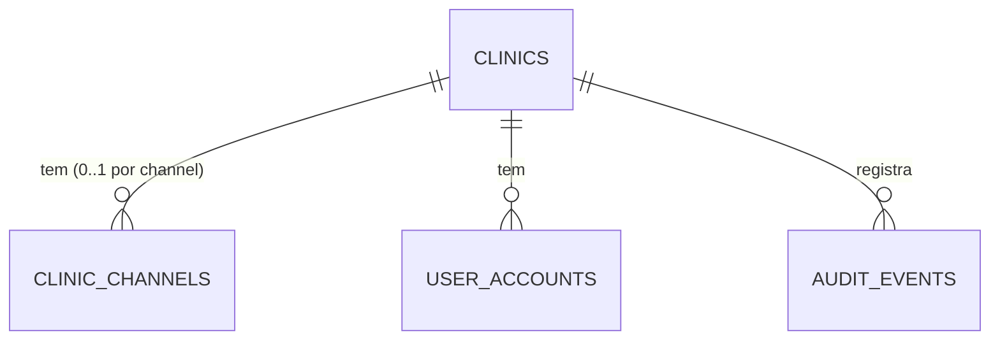

# Plataforma agnóstica: canal de e-mail por clínica e `/plataforma` organizado

> Plan this with **tlc-plan**.
> Decisions below carry the literal shape - copy them, do not re-derive them.

## Situation

- Project: em construção ativa, antes do go-live (primeira clínica ainda não está no ar).
- Decision: comprometida por @KalleoPinheiro, 2026-10-10, nesta sessão de discovery — construir **antes do go-live**, com permissão para mudar esquema e comportamento "de forma segura e consciente".
- In flight: RM-20 (Portal do Super Admin, [#214](https://github.com/KalleoPinheiro/vitta-flow/issues/214)) entregue; este trabalho estende `/plataforma` e reverte a premissa de `.design/lembretes-custo-zero.md` de que o e-mail sai pela conta única do Vitta Flow. Decisões abertas relacionadas e não tocadas: #215, #248, #250, #251, #210.
- At stake: caro — muda por onde **todo** e-mail sai (convite, redefinição de senha, lembretes) e guarda segredo de terceiros por clínica. Errar deixa uma clínica sem acesso ou expõe chave de API.

## Problem

Construção. O produto foi prometido como multiempresa em que cada clínica é dona da própria operação (ADR-001, ADR-007). Hoje, porém, todo e-mail de todas as clínicas sai de uma conta Resend única do operador (`RESEND_API_KEY`, `src/infrastructure/email/resend-email-gateway.ts`), que é obrigatória em produção. O operador paga o tráfego de todas as clínicas, o remetente nunca é o da clínica, e a plataforma não é agnóstica ao provedor. Com 3+ clínicas esperadas em 6 meses, o teto grátis (100/dia) estoura entre a 3ª e a 4ª clínica.

O dono quer a plataforma agnóstica e modular: cada clínica traz a própria chave e assume o custo, e sem chave a clínica não tem envio automático. O `/plataforma` também precisa ficar organizado, com navegação, a tela de importação de taxonomia (hoje só existe a API) e o status das integrações por clínica.

Por que agora e não depois: trocar o canal depois do go-live obriga a migrar uma clínica viva de "e-mail grátis da plataforma" para "traga sua chave".

## Evidence

- Resend Free: 3.000/mês, 100/dia; estoura entre a 3ª e a 4ª clínica — `.design/lembretes-custo-zero.md`, Evidence.
- 3+ clínicas esperadas nos próximos 6 meses — resposta do dono, 2026-10-10.
- Volume real de e-mail por clínica: desconhecido (nada em produção). O status do canal por clínica (C4) passa a mostrar o último resultado.

## Journey

Operador cria clínica → recebe o **link de convite** na tela (nunca por e-mail) → repassa ao admin → o admin define a senha → em `/configuracoes`, informa provedor, remetente e chave → clica em "Enviar teste" → passa a ter e-mail automático.

| Estado | O que acontece |
|---|---|
| Clínica sem canal | Lembretes não saem (contam `skipped`); convite e redefinição feitos pelo admin devolvem o link na tela; "Esqueci a senha" responde a mensagem neutra de sempre e nada sai |
| Canal configurado, envio falha (chave revogada, domínio não verificado) | Não há fallback para a conta da plataforma. O envio conta como `failed`, o último erro aparece no status (clínica e plataforma) e, se for convite ou redefinição, o link volta na tela |
| Admin esqueceu a senha e a clínica não tem canal | O super admin gera o link de redefinição em `/plataforma/clinicas/[id]` e repassa |
| Conta da plataforma (super admin) | Usa o canal da plataforma (`RESEND_API_KEY`/`EMAIL_FROM`, agora opcionais); sem ele, recuperação por script (ADR-009) |
| Chave salva | Nunca é lida de volta: a tela mostra só `••••` + últimos 4 caracteres |
| Canal removido | Envio para imediatamente; o histórico de status some com a linha |
| Super admin quer operar a clínica | Já é possível: convidar o próprio e-mail como `company_admin` (conta separada, **senha diferente**, ADR-007 Negativas). Nada a construir |

## Verdict

already committed - see Situation. Build, antes do go-live. Confirmado por @KalleoPinheiro, 2026-10-10.

Cheaper paths considered:
- Conta única no Resend Pro (~US$ 20/mês) e repasse do custo — descartado pelo dono: a plataforma tem de ser agnóstica e cada clínica responde pelo próprio custo.
- Tela para editar o `.env` — descartado: o operador é quem faz o deploy, então a tela só adicionaria superfície de ataque.
- Padrões de clínica nova configuráveis pelo super admin — descartado pelo dono por LGPD: só o admin da clínica edita (já existe em `/configuracoes`).

## Success

- Worked if: no go-live, **zero** e-mails em nome de clínica saem da conta Resend da plataforma, e a primeira clínica envia lembretes pela própria chave — até o go-live.
- Early signal: o status em `/plataforma` mostra cada clínica ativa com o canal "configurado, último teste ok". Se aparecer clínica ativa "sem canal" depois da primeira semana, a aposta está indo mal.
- Review: na 3ª clínica — @KalleoPinheiro confere se alguma ainda depende de link manual.

## Boundary

In:
- Canal de e-mail por clínica: tabela, chave cifrada, resolução por escopo no container, contrato de provedor (só Resend).
- Todo envio de clínica (convite, reenvio, redefinição, lembretes) pelo canal da clínica; link manual quando não sai.
- Redefinição gerada pelo admin (clínica) e pelo super admin (para `company_admin`).
- Tela do canal em `/configuracoes` (só `company_admin`).
- `/plataforma`: navegação, status do canal por clínica, tela de importação de taxonomia.
- ADR novo; docs de comunicação, acesso, integrações e produção.

Out:
- WhatsApp automático pela Meta (RM-14) — Later; a tabela já admite `channel = 'whatsapp'`, mas nada é implementado.
- Outros provedores (SMTP, SES) — o contrato fica pronto e a implementação vem depois.
- Padrões de clínica nova editáveis pela plataforma — decisão do dono (LGPD).
- Planos, módulos pagos e cobrança por clínica — Fase 3 do ADR-001.
- Google Agenda (já é por clínica) e fotos em S3 (infraestrutura do prontuário).
- Acesso do super admin a dado clínico — continua fechado (ADR-007).

## Prior art

- No próprio repositório: o Google Agenda já é credencial por clínica, com refresh token cifrado pela chave de dados (`google_accounts`, `container.ts` `oauthCalendarGateway`, cache por clínica da issue #74). O canal de e-mail copia esse molde: cifrar com `currentDataCipher()` e manter o cache com chave por clínica.
- A falha que esse molde já reportou é a issue #74: um cache global sem clínica na chave reaproveitou a credencial de uma empresa em outra. Aqui o gateway é montado por escopo, nunca global.
- Web não consultada: pouco a decidir fora do repositório, porque o padrão BYOK com segredo só de escrita é conhecido e o provedor já está integrado.

## Shape

A aposta é usar uma linha por clínica e por canal (`clinic_channels`), com o segredo cifrado pela chave de dados, e resolver o `EmailGateway` pelo escopo no container: clínica → canal dela; plataforma → env; sem canal → nulo, também em produção. A porta `EmailGateway` não muda, então trocar de provedor é um gateway novo e um valor de enum. Mudar depois é caro só em um ponto: a regra "sem canal, sem e-mail". Ela vale para convite e redefinição e foi escolhida conscientemente.

### Adds

- Tabela `clinic_channels` (migração drizzle) — ver Decisions.
- `src/domain/clinic/clinic-channel.ts` — entidade `ClinicChannel` + `ClinicChannelRepository`; `CHANNEL_KINDS = ['email'] as const`, `EMAIL_PROVIDERS = ['resend'] as const`.
- `src/infrastructure/persistence/drizzle/drizzle-clinic-channel-repository.ts` (+ fake in-memory).
- `emailGatewayFor(db, clinicId)` em `src/infrastructure/container.ts` (lazy, como `calendarGatewayFor`).
- `src/application/clinic/manage-email-channel.ts` — salvar, testar, remover.
- `GET|PUT|DELETE /api/settings/email-channel`, `POST /api/settings/email-channel/test` — família `administrative` (`company_admin`).
- `POST /api/accounts/[id]/reset-link` — admin da clínica gera a redefinição.
- `'reset-link'` em `ADMIN_ACTIONS` (`src/application/platform/manage-clinic-admins.ts`).
- Seção "Canal de e-mail" em `src/app/(staff)/configuracoes/` (`email-channel-section.tsx`).
- `src/app/plataforma/taxonomia/page.tsx` — botão de importação do catálogo curado sobre `POST /api/platform/taxonomy/import`, com o resultado.
- Navegação de `/plataforma` (Clínicas · Auditoria · Taxonomia) em `src/app/plataforma/layout.tsx`.
- Status do canal na lista e no detalhe da clínica em `/plataforma` (`GET /api/platform/clinics` e `[id]` ganham `emailChannel`).
- `docs/adr/011-canal-de-comunicacao-por-clinica.md`.

### Changes

- `container.ts:416` `email: buildEmailGateway()` → `email: emailGatewayFor(db, tenant.clinicId)`.
- `buildEmailGateway()` → `platformEmailGateway()`: `RESEND_API_KEY`/`EMAIL_FROM` passam a ser **opcionais e só da plataforma**; produção não lança mais sem eles.
- `IssueAuthToken.issueAndTryDeliver` passa a ser o único caminho de convite/redefinição feito por alguém logado; as rotas devolvem `inviteUrl` quando `delivered === false`.
- `POST /api/platform/clinics` → o convite do 1º admin **nunca** é enviado por e-mail; a resposta traz `admin.inviteUrl`.
- `POST /api/accounts`, `POST /api/accounts/[id]/resend-invite`, `PATCH /api/platform/clinics/[id]/admins/[accountId]` (`resend-invite`) → devolvem `inviteUrl` quando não entregue.
- `src/app/api/auth/forgot-password/route.ts` → `getRepositories(clinicScope(account.clinicId))` por conta (super admin: `systemScope()` → canal da plataforma); resposta neutra inalterada.
- `SendReminders` → perde o parâmetro `email`; cada clínica usa `services.email`; `ReminderRunSummary.channelEnabled` sai do topo e vai para cada `ClinicReminderSummary` (`channel: 'configured' | 'none'`).
- `src/app/esqueci-senha/page.tsx` → texto: "Não recebeu? Peça ao administrador da sua clínica um link de redefinição."
- `src/lib/auth/route-family.ts` → `/api/settings/email-channel` em `administrative`.
- Docs: `docs/domains/comunicacao/README.md`, `docs/domains/acesso/README.md`, `docs/engineering/integrations/{README,resend}.md`, `docs/engineering/producao.md`, `docs/engineering/onboarding.md`, `.env.example`, `docs/plano-evolucao-faseado.md` (novo RM).

### Leaves

- WhatsApp Meta, SMTP/SES, padrões de clínica nova, cobrança, Google Agenda, S3, ADR-007 — ver Boundary Out.

A forma mais pesada seria um registro de "integrações" com módulos e permissões de uso por clínica (feature flags pagas e plano). Ela só se paga quando houver venda de módulo por clínica, o que é a Fase 3 do ADR-001 e não está no roadmap. Hoje o único recurso opcional é o e-mail, e o WhatsApp já cabe na coluna `channel`.

## Roadmap

| Block | Delivers | Clarity |
|---|---|---|
| C1 Canal de e-mail por clínica | `clinic_channels`, domínio + repositório, `emailGatewayFor`, e-mail da plataforma opcional, ADR-011 | clear |
| C2 Envios pelo canal da clínica + link manual | convite, reenvio, esqueci-senha por conta e lembretes pelo canal da clínica; `inviteUrl` quando não entregue; `reset-link` (clínica e plataforma) | clear |
| C3 Tela do canal em `/configuracoes` | API `email-channel` + seção com salvar, testar e remover; só `company_admin`; auditoria | clear |
| C4 `/plataforma` organizado | navegação, status do canal por clínica, tela de importação de taxonomia | clear |

Ordem: C1 → C2 e C3 (independentes entre si) → C4 (o status depende de C1 e o teste depende de C3). Tudo antes do go-live.

## Decisions

| Decision | Choice | Why this | Alternative, and what would make it win | Reversibility |
|---|---|---|---|---|
| Modelo de envio | Nenhum e-mail de clínica sai pelo canal da plataforma; sem fallback | Dono: plataforma agnóstica, custo da clínica | Fallback para a conta da plataforma — se o dono aceitar pagar o tráfego | costly |
| Tabela | `clinic_channels(id text pk, clinic_id text not null references clinics(id), channel text not null, provider text not null, sender text not null, encrypted_secret text not null, secret_last4 text not null, last_status text null, last_status_at timestamptz null, last_error text null, updated_at timestamptz not null, updated_by text not null)`; `unique (clinic_id, channel)`; `check (channel in ('email'))`; `check (last_status in ('ok','failed'))` | Uma linha por canal, sem tabela nova para WhatsApp | Registro genérico de integrações com JSON — se vierem 3+ provedores com formatos distintos | costly |
| Segredo | `currentDataCipher().encrypt(apiKey)` (ADR-006); nunca devolvido por API, log ou auditoria; a resposta traz só `secretLast4` | Mesmo molde do refresh token Google | KMS externo — se houver exigência de conformidade | reversible |
| `last_error` | mensagem do provedor truncada a 300 caracteres, sem destinatário | É o diagnóstico de que o admin precisa, sem PII | — | reversible |
| Resolução do gateway | `emailGatewayFor(db, clinicId)`: `clinicId` → `LazyEmailGateway` lendo `clinic_channels` (canal `email`), senão `NullEmailGateway`; `clinicId === null` → `platformEmailGateway()` (env) ou nulo. **Sem cache global de credencial** | Escopo explícito; evita a reincidência da #74 | Cache por clínica como o do calendário — se a leitura por request pesar | reversible |
| E-mail da plataforma | `RESEND_API_KEY`/`EMAIL_FROM` opcionais, usados só com `systemScope()` (bootstrap e redefinição do super admin) | Dono: canal só da plataforma | Renomear para `PLATFORM_*` — se houver confusão operacional | reversible |
| Boot em produção | Sem `RESEND_API_KEY` não lança mais; `APP_URL` https continua obrigatória | O canal virou opcional | — | reversible |
| Convite do 1º admin | `POST /api/platform/clinics` não envia e-mail; responde `admin.inviteUrl` (link de 24 h) e a UI mostra para copiar | Dono: só link manual; a clínica ainda não tem canal | — | reversible |
| Link quando não entregue | Rotas de convite, reenvio e redefinição por admin respondem `{ delivered: false, inviteUrl }`; com `delivered: true`, `inviteUrl: null` | O link nunca se perde, nem fica exposto quando o e-mail saiu | — | reversible |
| Redefinição pelo admin | `POST /api/accounts/[id]/reset-link` (`company_admin`; alvo da mesma clínica e dentro de `PROVISIONING_MATRIX.company_admin`); emite token `reset` de 1 h; audita `action: 'update', resourceType: 'account', detail: 'reset-link'`. Plataforma: `ADMIN_ACTIONS` + `'reset-link'` só para `company_admin` | Dono: "admin gera link" | Só reconvite — se o risco de o admin assumir a conta pesar mais | costly |
| Esqueci a senha | Por conta: `clinicScope(account.clinicId)` → canal da clínica; resposta neutra idêntica | Cada conta sai pelo canal da sua clínica | — | reversible |
| Lembretes sem canal | `ClinicReminders` conta `skipped`, não grava log; resumo por clínica com `channel: 'none'` | Clínica sem canal não envia | — | reversible |
| Quem configura o canal | Só `company_admin` (família `administrative`); o super admin vê o status, nunca a chave nem o formulário | Dono; LGPD e ADR-007 | Super admin também — se clínicas pedirem configuração assistida | reversible |
| Teste do canal | `POST /api/settings/email-channel/test` envia para o e-mail da conta logada; grava `last_status`/`last_status_at`/`last_error` | Prova a chave e o domínio antes de um envio real | Validar ao salvar — descartado: latência e falso negativo transitório | reversible |
| Auditoria | `resourceType: 'clinic_channel'`, `action: 'create' \| 'update' \| 'delete'`, `detail: 'test-ok' \| 'test-failed'` no teste; nunca o segredo | Mutação sobre credencial é ato auditável | — | reversible |
| Status na plataforma | `emailChannel: { configured: boolean; provider: 'resend' \| null; lastStatus: 'ok' \| 'failed' \| null; lastStatusAt: string \| null }` em `GET /api/platform/clinics` e `[id]`; sem `sender`, sem `last_error` | Metadado operacional, sem segredo | Mostrar `last_error` — se o suporte precisar diagnosticar | reversible |
| Taxonomia | `/plataforma/taxonomia`: botão "Importar catálogo de estomaterapia" → `POST /api/platform/taxonomy/import`; mostra as contagens devolvidas; catálogo licenciado continua por `scripts/import-taxonomy.ts` | A API existe; falta a tela | Upload de arquivo licenciado pela tela — quando um cliente pedir | reversible |
| ADR | `docs/adr/011-canal-de-comunicacao-por-clinica.md`, que substitui a linha do ADR-004 sobre e-mail transacional obrigatório | Decisão durável e surpreendente | — | reversible |

## Open

1. Recipiente do e-mail de teste — default: o e-mail da conta logada.
2. Renomear as variáveis da plataforma para `PLATFORM_*` — default: manter os nomes e documentar.
3. Rate limit de `reset-link` e de `email-channel/test` — default: o mesmo `SharedRateLimiter` de 5/min por conta.
4. Mostrar ao admin, ao criar uma conta sem canal, um aviso "e-mail desativado nesta clínica" — default: sim, ao lado do link.

## Sources

- `src/infrastructure/container.ts:416` — `email: buildEmailGateway()` global, o ponto da troca.
- `src/infrastructure/email/resend-email-gateway.ts` `buildEmailGateway` — lança em produção sem Resend.
- `src/app/api/auth/forgot-password/route.ts` — redefinição em `systemScope()`.
- `src/app/api/reminders/run/route.ts:46` — `SendReminders` recebe um gateway único.
- `src/app/api/auth/login/route.ts:144` — mesmo e-mail com senhas diferentes desambigua; senha igual dá `ambiguous_credentials`.
- `docs/adr/007-super-admin-operador-da-plataforma.md` linhas 80–81 — super admin convidar o próprio e-mail como `company_admin` é aceito.
- `.design/lembretes-custo-zero.md` — teto do Resend Free e premissa anterior de conta única.
