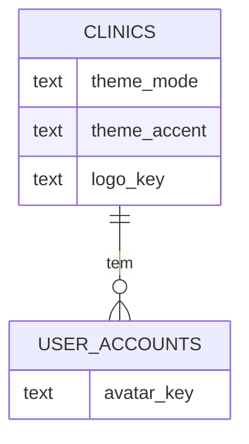

# Identidade visual mobile-first: tema, cor e logo por clínica

> Plan this with **tlc-plan**.
> Decisions below carry the literal shape - copy them, do not re-derive them.

## Situation

- Project: em uso (clínicas reais ativas em produção desde 2026-10-20), ainda sem paciente real.
- Decision: comprometida por @KalleoPinheiro, 2026-10-20, nesta sessão de discovery.
- In flight: `@still-void/ui` 3.4 já traz `data-theme` (claro/escuro), `data-accent` (cyan, violet, mint, amber), `ThemeProvider`, `ThemeToggle`, `ThemeScript`; o app não usa nada disso (`src/app/layout.tsx` fixa `data-theme="light" data-accent="violet"`). Este trabalho liga o que existe e toca o menu do staff (`src/app/(staff)/staff-layout-client.tsx`, `staff-nav.tsx`), `/configuracoes` e `/minha-conta`.
- At stake: reversível em sua maior parte (visual). O que custa é a migração de colunas na clínica e o upload de arquivos (logo, avatar), que é dado pessoal no caso do avatar.

## Problem

Ausência e construção. O visual atual é considerado "sem graça" pelo dono e não é pensado primeiro para o celular (menu lateral de 224px, tabelas largas). Quem não consegue hoje: a clínica não coloca a própria marca no sistema (logo, cor) e ninguém escolhe tema claro/escuro. O que fazem no lugar: nada; usam o visual único violeta/claro. O que continua impossível sem isto: o profissional usar o sistema com conforto no celular durante o atendimento e a clínica apresentar uma identidade própria a equipe e pacientes (login, comprovantes).

Por que agora: o produto acabou de entrar em produção e a primeira impressão das clínicas reais é este visual; o Still Void já tem o mecanismo pronto, então o custo de ligar é baixo.

## Evidence

- Still Void 3.4 expõe `ThemeProvider`, `ThemeToggle`, `ThemeScript` e as 4 cores com contraste AA calibrado - `still-void/src/react/client/`, `src/css/theme.css`.
- `src/app/layout.tsx` fixa `data-theme="light" data-accent="violet"`; não há seletor em lugar nenhum do app.
- Quanto do uso real é em celular: desconhecido (nada instrumentado). Para medir seria preciso registrar largura de tela agregada, sem dado pessoal; fora deste escopo.

## Journey

Admin da clínica abre `/configuracoes` → "Identidade": envia logo, escolhe tema padrão (claro, escuro, automático) e uma das 4 cores, vê a prévia, salva. Toda a equipe passa a ver a clínica com aquela cor e logo. Cada pessoa pode alternar claro/escuro no próprio aparelho (`ThemeToggle`) e subir seu avatar em `/minha-conta`.

Estados:
- Clínica sem identidade configurada: cor `violet`, tema `system`, sem logo (hoje: `BrandLogo` do EstomaSysTech).
- Sem logo: iniciais da clínica em quadrado com a cor de destaque.
- Sem avatar: iniciais da pessoa em círculo.
- Arquivo grande demais ou tipo inválido: erro claro no campo, nada é salvo.
- Armazenamento indisponível (`unavailable-photo-storage`): enviar logo/avatar fica desabilitado com aviso; cor e tema continuam funcionando.
- Pessoa sem papel de admin: vê a identidade, não edita.
- Preferência claro/escuro da pessoa é do aparelho; se nunca escolheu, segue o padrão da clínica.
- Troca de cor: vale na próxima navegação de toda a equipe (sem recarregar sessão).
- Login e portal do paciente: usam tema e logo da clínica quando a clínica é conhecida; sem clínica, o padrão.

## Verdict

Construir. Já comprometido - see Situation.

Cheaper paths considered: só trocar o `defaultAccent` e o CSS global (resolve "sem graça", não resolve personalização nem mobile); tema só no aparelho com `localStorage` (descartado pelo dono: a clínica é quem define); cor livre em hex (descartado, contraste AA só garantido nas 4 cores).

## Success

- Worked if: as 2 clínicas reais configuram identidade própria e o dono avalia o celular como utilizável no atendimento - até 2 semanas após o release.
- Early signal: admin conclui "Identidade" sem ajuda; se pedir ajuda ou desistir no upload do logo, o fluxo está errado.
- Review: 2 semanas após o release em produção - @KalleoPinheiro.
- Não mensurável hoje: uso em celular. Proxy: relato do dono e das clínicas.

## Boundary

In: layout mobile-first do staff (barra inferior, tela "Hoje", tabelas em cartões), tema/cor/logo por clínica, avatar da equipe.
Out: avatar de paciente - dado de saúde e menor de idade, decisão jurídica (#376). Cor livre em hex - contraste. Redesenho do portal do paciente - fatia seguinte, depois de validar o staff.

## Prior art

- Not checked: sem pesquisa externa; as 4 cores com AA já são convenção do Still Void, que prevalece (port, don't redesign).

## Shape

Aposta: a identidade vive na linha da clínica (3 colunas + 1 arquivo) e é renderizada no servidor em `data-theme`/`data-accent`, sem flash. O layout mobile troca o menu lateral por barra inferior. Mudar depois é barato (colunas nulas, padrão do Still Void).

### Adds

- Migração `0067` (conferir numeração na main): `clinics.theme_mode text not null default 'system'` (`light|dark|system`), `clinics.theme_accent text not null default 'violet'` (`cyan|violet|mint|amber`), `clinics.logo_key text null`, `user_accounts.avatar_key text null`.
- `src/domain/clinic/clinic-identity.ts`: `ThemeMode`, `ThemeAccent`, validação de tipo e tamanho de imagem (`MAX_IDENTITY_IMAGE_BYTES = 1 * 1024 * 1024`, `image/png|jpeg|webp`; SVG fora do avatar).
- Endpoints `PUT /api/clinic/identity`, `POST|DELETE /api/clinic/logo`, `POST|DELETE /api/account/avatar`, `GET /api/clinic/logo` e `GET /api/account/avatar/[id]`, atrás de `sessionScope`/`writeScope`, admin da clínica para identidade.
- Seção "Identidade" em `/configuracoes` e campo de avatar em `/minha-conta` (telas em `.design`/Claude Design: Identidade e Aparência).
- `src/components/app-shell` com barra inferior (`Hoje`, `Agenda`, `Pacientes`, `Mais`) abaixo de `md`, menu lateral a partir de `md`.
- Raiz: `ThemeProvider` com `storageKey="estomasystech:modo"` só para o modo; `ThemeScript` no `<html>`.

- Peculiaridades de iOS e Android (valem para todo o shell mobile):
  - `export const viewport = { viewportFit: 'cover', themeColor: [...] }` com `theme-color` claro e escuro (barra do navegador e status bar do Android; Safari iOS usa o mesmo).
  - Barra inferior e botões fixos com `padding-bottom: env(safe-area-inset-bottom)`; cabeçalho com `env(safe-area-inset-top)` (notch, ilha dinâmica, barra de gestos).
  - Altura de tela com `100dvh`, nunca `100vh` (a barra de endereço do Safari e do Chrome encolhe e cresce).
  - Campos de formulário com fonte de pelo menos 16px: abaixo disso o Safari do iOS dá zoom ao focar. Teclado virtual: rodapé fixo sobe com `visualViewport`, para o botão "Salvar" não ficar escondido.
  - Alvo de toque mínimo de 44pt (iOS) e 48dp (Android); o Still Void já garante 24px, o shell mobile eleva para 44px.
  - Gestos de voltar: Android (botão/gesto) e iOS (deslizar da borda) precisam voltar uma tela, então navegação por rotas reais, e modais e gavetas fecham no voltar (`history`), sem aprisionar o usuário.
  - `color-scheme` e `ThemeScript` no `<html>` para o modo automático seguir `prefers-color-scheme` sem flash; `-webkit-tap-highlight-color: transparent` e `overscroll-behavior: none` no shell para não parecer página web puxável.
  - `prefers-reduced-motion` respeitado nas transições do shell.
  - Upload de logo e avatar com `accept="image/png,image/jpeg,image/webp,image/heic"` e câmera no celular; iOS entrega HEIC, então o servidor converte para JPEG antes de guardar (ou o cliente redimensiona em canvas). Ver Decisions.
  - Instalar na tela inicial: `app/manifest.ts` (nome, `display: standalone`, `theme_color`, `background_color`, ícones 192/512 e maskable) e `apple-touch-icon` 180px; sem service worker agora (offline em saúde exige decisão própria).
  - Links nativos: `tel:` e o botão de WhatsApp existente abrem o app certo em cada sistema.

- Acessibilidade priorizada (WCAG 2.2 AA como piso, critério de pronto de todo bloco):
  - `tests/lib/contraste-tema.test.ts`: calcula o contraste de cada par de token usado (texto, texto secundário, acento como texto, texto sobre botão de acento, selo de estado) nas 4 cores × 2 modos e falha abaixo de 4,5:1 (3:1 para texto grande e bordas de componente). Hoje o texto `#0a0a0c` sobre o acento é o par a conferir.
  - Estados nunca só por cor: selo de status sempre com texto; ícone mais texto em alertas.
  - Foco visível em todo controle (anel de 2px com contraste 3:1 sobre o fundo, sem `outline: none`), ordem de tab igual à ordem visual, "pular para o conteúdo" no shell.
  - Leitores de tela (VoiceOver no iOS, TalkBack no Android): barra inferior é `<nav aria-label>` com `aria-current="page"`; seletores de tema e cor são `radiogroup` com `aria-checked`; ícones sem texto levam `aria-label`; logo com `alt` = nome da clínica, avatar com `alt` vazio quando o nome já aparece ao lado.
  - Texto ampliável: fontes em `rem`, layout sem quebra a 200% de zoom e com a fonte grande do sistema (iOS Dynamic Type e tamanho de fonte do Android); sem `maximum-scale` nem `user-scalable=no`.
  - Alvos de toque de 44px com 8px de espaço entre alvos vizinhos.
  - Movimento: `prefers-reduced-motion` desliga transições; sem animação automática.
  - Modo de alto contraste do sistema (`forced-colors`) mantém borda nos cartões e botões.
  - Erros de formulário ligados ao campo (`aria-describedby`) e anunciados (`role="alert"`), em linguagem simples.
  - E2E com `@axe-core/playwright` nas telas novas (Hoje, Identidade, Aparência, `/login`) no `gate:local`, 0 violações sérias ou críticas.

### Changes

- `src/app/layout.tsx` → lê identidade da clínica da sessão e renderiza `data-theme`/`data-accent`; sem sessão, padrão `system`/`violet`.
- `src/components/brand-logo.tsx` → mostra a logo da clínica quando houver, senão iniciais.
- `StaffNav`/`staff-layout-client.tsx` → shell responsivo; `SidebarProvider` fica só no desktop.
- Telas de lista (pacientes, faturamento) → cartões abaixo de `md`.
- `src/app/(staff)/page.tsx` → vira "Hoje" (próximo atendimento, números do dia, agenda).

### Leaves

- Portal do paciente, e-mails e PDFs (logo nos comprovantes é fatia seguinte, ver Roadmap).
- Papéis e autorização existentes; auditoria já cobre mudança de configuração.

A versão pesada (tema por usuário no banco, cor livre, temas completos) só compensa se houver pedido de clínica por marca própria completa; nada no roadmap pede isso.

## Roadmap

| Block | Delivers | Clarity |
|---|---|---|
| Fundação de tema | `data-theme`/`data-accent` ligados no layout, `ThemeToggle` no aparelho, padrão claro/violeta | clear |
| Identidade da clínica | colunas, endpoints e seção em `/configuracoes` (cor, tema padrão) | clear |
| Logo e avatar | upload no mesmo armazenamento das fotos, limites, iniciais como fallback | clear |
| Shell mobile e "Hoje" | barra inferior, tela inicial nova | design |
| Listas em cartões | pacientes, faturamento, repasses em telas pequenas | design |
| Logo em login e comprovantes | logo no login, PDFs e e-mails | open |
| Trava de acessibilidade | teste de contraste dos tokens + axe no E2E, antes dos demais blocos | clear |
| Peculiaridades iOS/Android | viewport, safe-area, `100dvh`, manifest, HEIC, gesto de voltar | spike |

## Decisions

| Decision | Choice | Why this | Alternative, and what would make it win | Reversibility |
|---|---|---|---|---|
| Onde guardar tema e cor | `clinics.theme_mode`, `clinics.theme_accent` | dono quer a clínica no controle; vale para a equipe toda | por usuário no banco, se clínicas pedirem cor por pessoa | costly |
| Modo claro/escuro por pessoa | `ThemeProvider` + `localStorage` `estomasystech:modo`, padrão da clínica | conforto individual, sem coluna nova; confirmado pelo dono | coluna em `user_accounts`, se a pessoa reclamar de perder a preferência ao trocar de aparelho | reversible |
| Cores permitidas | enum `cyan\|violet\|mint\|amber` | contraste AA calibrado no Still Void | hex livre, só se o Still Void gerar o par de contraste automaticamente | reversible |
| Padrão de clínica sem configuração | `system` + `violet` | preserva o visual atual | — | reversible |
| Armazenamento de logo/avatar | mesmo `PhotoStorage` das fotos clínicas (S3/R2 cifrado), chaves `logo_key`/`avatar_key` | já cifrado e com adaptador local/indisponível | bucket público de ativos, se o carregamento do login pesar | costly |
| Limites de imagem | até 1 MB; logo e avatar aceitam `png`, `jpeg`, `webp`, `gif`, `avif`, `heic` e `svg` (decidido por @KalleoPinheiro, 2026-10-20) | formatos comuns de imagem | restringir a raster, se aparecer abuso | reversible |
| SVG seguro | sanitizar no envio com allowlist de elementos e atributos (sem `script`, `foreignObject`, `on*`, `href` externo, `javascript:`, `style` com `url()`); gravar o SVG já limpo; servir em `GET` com `Content-Type: image/svg+xml`, `X-Content-Type-Options: nosniff`, `Content-Security-Policy: default-src 'none'; style-src 'unsafe-inline'; sandbox`; exibir só por ``, nunca inline; teste com payloads de XSS conhecidos | SVG é XML executável: a defesa tem de existir no envio, na entrega e na exibição | converter SVG em PNG no envio, se a sanitização der falso negativo | costly |
| Acessibilidade | WCAG 2.2 AA como piso; teste de contraste dos tokens e `@axe-core/playwright` no `gate:local` | dado de saúde e públicos com mobilidade ou visão reduzida; trava automática evita regressão | auditoria manual com leitor de tela por release, em complemento e não no lugar | reversible |
| Telas com entalhe e barra de gestos | `viewport-fit=cover` + `env(safe-area-inset-*)` + `100dvh` | evita barra inferior escondida no iPhone e salto de altura no Chrome Android | — | reversible |
| Foto do iOS (HEIC) | aceitar `image/heic` no envio e converter para JPEG no servidor (`sharp`), limite 1 MB após conversão | iPhone tira HEIC por padrão e o Chrome não renderiza | redimensionar no cliente com canvas, se a conversão no servidor pesar | costly |
| Instalar como app | `manifest.ts` standalone + `apple-touch-icon`, sem service worker | dá ícone e tela cheia sem custo de cache offline de dado de saúde | PWA completo com offline, só após decisão de LGPD sobre cache local | reversible |
| Avatar | só equipe; iniciais como padrão | paciente é dado de saúde e menor (#376) | avatar de paciente, só após revisão jurídica | one-way se publicado |
| Mobile-first | barra inferior abaixo de `md`, lateral a partir de `md` | alvo de toque e polegar | manter menu lateral em gaveta, se a barra não couber os papéis | reversible |

## Cobertura das telas existentes no Claude Design

Canvas: https://claude.ai/artifact/Jmb2Gcr4LH3nVVeYzgSzeU (celular 390×844 e web 1280, mesmos tokens do Still Void).

| Tela do app | Rota | No desenho |
|---|---|---|
| Início | `/` | Hoje (celular), Início (web) |
| Agenda | `/agenda` | Agenda dia com tempo real do procedimento |
| Triagem | `/triagem` | cartões de foto com Avaliar e Pedir nova foto |
| Pacientes e prontuário | `/pacientes`, `/pacientes/[id]` | lista em cartões (celular) e tabela (web); prontuário com evolução, TIME e abas |
| Faturamento | `/faturamento` | cartões (celular) e tabela (web) |
| Procedimentos, Materiais, Profissionais, Parceiros | `/procedimentos`, `/materiais`, `/profissionais`, `/parceiros` | um desenho de referência (procedimentos): lista mais ficha (web), cartões e folha de formulário (celular); os outros três reusam o padrão |
| Relatórios, Repasses | `/relatorios`, `/repasses` | indicadores e extrato |
| Auditoria e Pedidos do titular | `/auditoria`, `/pedidos-titular` | duas abas na mesma tela |
| Configurações com Identidade | `/configuracoes` | hub (celular) e seções (web) |
| Minha conta com avatar | `/minha-conta` | foto, aparência no aparelho, senha, duas etapas |
| Entrar (e esqueci/definir senha) | `/login`, `/esqueci-senha`, `/definir-senha` | Entrar; as outras duas reusam o formulário |
| Portal do paciente | `/portal` | próxima consulta, evolução, consentimentos |
| Plataforma (operador) | `/plataforma/**` | lista de clínicas; subtelas reusam o padrão |
| "Mais" por papel | menu | Admin, Atendente e Profissional |

Fora desta rodada: documentos impressos `/documentos/**` (A4, recebem só o logo da clínica) e `/privacidade` (texto longo, só tema).

## Needs design

Cannot be planned until somebody draws it.

1. Shell mobile e "Hoje" - estados vazio, sem permissão (papéis sem resumo financeiro), carregando; proposta inicial já desenhada.
2. Listas em cartões - paciente, fatura e repasse em 390px, ações por item, filtros.
3. Barra inferior por papel - Atendente, Profissional e Admin veem atalhos diferentes; o que vai em "Mais".

## Needs a spike

1. Conversão HEIC no servidor - `sharp` com HEIC funciona no build do Dockerfile do Coolify? Se não, cai para redimensionar no cliente. Para quando uma foto HEIC real de iPhone virar JPEG em teste local.
2. Comportamento em aparelhos reais (Safari iOS e Chrome Android) do rodapé fixo com teclado aberto e da gaveta com gesto de voltar - só se mede no aparelho; para quando as duas telas de formulário (agenda e paciente) se comportarem nos dois.

## "Mais" por papel

A barra inferior tem no máximo 5 atalhos (limite do iOS). O que sobra vai em "Mais", uma tela de lista agrupada que respeita `canRoleAccess`.

| Papel | Barra | Em "Mais" |
|---|---|---|
| Admin da clínica | Hoje, Agenda, Pacientes, Faturas, Mais | Triagem, Parceiros, Profissionais, Procedimentos, Materiais, Relatórios, Repasses, Auditoria, Pedidos do titular, Configurações, Minha conta, Sair |
| Atendente | Hoje, Agenda, Pacientes, Mais | Parceiros, Configurações, Minha conta, Sair |
| Profissional | Hoje, Agenda, Triagem (com contador), Pacientes, Mais | Parceiros, Repasses, Configurações, Minha conta, Sair |

## Open

2. Logo na barra e login antes de a clínica estar identificada - padrão: logo do EstomaSysTech.
3. Troca de cor em sessão aberta - padrão: vale na próxima navegação.

## Sources

- Canvas de layout (Claude Design): https://claude.ai/artifact/Jmb2Gcr4LH3nVVeYzgSzeU - Hoje, Aparência, Identidade da clínica.
- Still Void `src/react/client/ThemeProvider.tsx`, `src/css/theme.css` - mecanismo de tema e cores com AA.
- `src/app/layout.tsx`, `src/app/(staff)/staff-layout-client.tsx` - estado atual.
