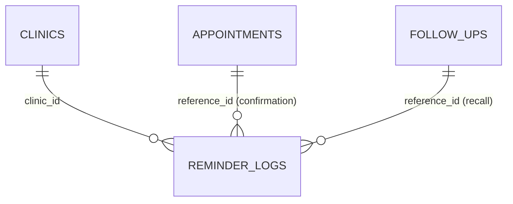

# Lembretes ao paciente sem custo de mensageria

> Plan this with **tlc-plan**.
> Decisions below carry the literal shape - copy them, do not re-derive them.

## Situation

- Project: in active construction — não está em produção; 1 clínica no radar para começar.
- Decision: open — o RM-14 (templates da Meta) estava em Now; o usuário questionou o custo da API oficial.
- In flight: `.specs/features/lembretes-whatsapp-templates-cadencia/spec.md` (RM-14, especificado, não iniciado) — as entregas 2 (cadência, N2) e 3 (escopo por empresa, N3) valem para qualquer canal e são reaproveitadas aqui; a entrega 1 (templates Meta) vai para Later.
- At stake: costly, não one-way — o canal fica atrás de porta (`MessagingGateway`/`EmailGateway`) e ligar a Meta depois é aditivo. O único ponto caro é a migração de `reminder_logs`, que deve sair numa só vez.

## Problem

Construção. O produto promete lembrete de confirmação D-1 e recall de retorno vencido
([comunicação](../docs/domains/comunicacao/README.md), COM-RN-01/02). O canal implementado —
WhatsApp por texto livre na Meta Cloud API — não entrega fora da janela de 24 h (N1), e a correção
prevista (templates *utility*) passa a custar por mensagem entregue. A premissa do negócio é custo
de mensageria zero para a clínica.

Sem esta peça, a primeira clínica entra em produção sem nenhum lembrete chegando ao paciente: o job
roda, conta tudo como `failed` (com credenciais) ou como dry-run (sem), e ninguém é avisado.
Por que agora: é o próximo item do roadmap (RM-14 estava em Now) e bloqueia o go-live com lembretes;
o recall sem teto (N2) vira spam real em qualquer canal que de fato entregue.

## Evidence

- Meta, categoria *utility* no Brasil: ~R$ 0,04–0,05 por mensagem entregue (~US$ 0,008); grátis dentro da janela de 24 h aberta pelo paciente — fontes secundárias (a página da Meta está bloqueada no ambiente desta discovery). Para ~400 consultas/mês ≈ R$ 20/mês por clínica.
- Resend grátis: 3.000 e-mails/mês e **100/dia** — a conta Resend é única do Vitta Flow (`RESEND_API_KEY`), então o custo do e-mail é do Vitta Flow, não da clínica. 1 clínica cabe; na 3ª–4ª clínica o teto diário estoura (Pro ~US$ 20/mês).
- Consultas/dia da primeira clínica: **desconhecido** — ela hoje não confirma nada à mão; passará a confirmar pelo sistema. Não é "pequeno", é não medido: mede-se pelos `reminder_logs` do canal `whatsapp_link` após o go-live.
- Bounce de e-mail: não observável no sistema (o gateway só vê erro síncrono da API; bounce é assíncrono no painel do Resend). Medir exigiria webhook do Resend — fora do escopo.
- Adoção do portal pelos pacientes: desconhecida — é o número que reabre o push.

## Journey

Confirmado com o usuário: a recepção confirmará as consultas manualmente assim que o sistema for ao ar.

1. Cron diário (`POST /api/reminders/run`) envia por e-mail a confirmação das consultas `scheduled` de amanhã e o recall dos retornos `pending` vencidos, por empresa.
2. Na agenda, a recepção abre a consulta de amanhã e clica **Enviar WhatsApp**: abre o WhatsApp da clínica (app ou web) com a mensagem pronta; ela envia.
3. Paciente responde no WhatsApp; a recepção clica **Confirmar** (ação existente) — ou o paciente confirma no portal pelo link do e-mail (ação existente).
4. Na lista de retornos pendentes, mesmo botão para o recall.

Estados:

- **Paciente inativo** — pula (comportamento atual de `SendReminders`).
- **Consulta cancelada/remarcada depois do e-mail** — nada; D-1 só pega `scheduled` na hora do job.
- **WhatsApp já enviado hoje para esta consulta** — botão continua ativo, mas mostra "enviado hoje às HH:MM" (vem de `reminder_logs`), para duas recepcionistas não mandarem em dobro.
- **Telefone que não tem WhatsApp** — o próprio WhatsApp avisa; o sistema não valida.
- **Computador sem WhatsApp instalado** — `wa.me` abre o WhatsApp Web; nada a fazer.
- **E-mail falha na API** — conta `failed`, o lote segue (COM-RN-04 inalterada); o botão `wa.me` é o fallback humano.
- **Recall sem resposta** — para após a última tentativa da cadência (N2, D1/D2 do RM-14); o retorno continua `pending` para a equipe.
- **Sem `RESEND_API_KEY`** — dry-run como hoje; em produção o Resend já é obrigatório (ADR-004).

## Verdict

smaller or different — em vez de templates pagos da Meta (R$ ~20/mês por clínica e conta Meta obrigatória), e-mail automático pelo Resend já integrado + link `wa.me` de um clique para a recepção: R$ 0 de mensageria para a clínica, sem violar termos do WhatsApp e sem risco ao número. Custo de ficar como está: primeira clínica vai ao ar sem nenhum lembrete entregue. Confirmed by @KalleoPinheiro, 2026-09-25.

Cheaper paths considered:
- Meta Cloud API com templates *utility* — funciona e é barata, mas não é zero e exige conta Meta por clínica; vira opt-in por clínica em Later (RM-14).
- Janela grátis de 24 h da Meta — só abre quando o paciente escreve primeiro; não serve para D-1 nem recall proativo.
- APIs não oficiais (Baileys, whatsapp-web.js, Evolution API, WPPConnect) — violam os termos do WhatsApp, risco de banimento do número da clínica e dado de saúde numa sessão de WhatsApp Web no servidor; descartado por "segurança do dado antes de crescimento" (AGENTS.md) e LGPD.
- Push no portal (PWA) — not now: não há manifest nem service worker, só alcança quem tem conta no portal e aceitou, e no iOS exige instalar na tela inicial; volta quando a adoção do portal for medida.
- SMS — pago. Telegram — grátis, adoção baixa no público.

## Success

- Worked if: nos primeiros 30 dias da primeira clínica em produção, 100% das consultas `scheduled` do dia seguinte têm `reminder_log` de e-mail, a recepção usa o botão em vez de digitar, e o gasto de mensageria da clínica é R$ 0.
- Early signal: na primeira semana, `reminder_logs` com `channel = 'whatsapp_link'` por dia útil próximo do número de consultas de amanhã; se ficar perto de zero, a recepção voltou a digitar e o botão está no lugar errado ou não serve.
- Review: 30 dias após o go-live — @KalleoPinheiro. Gatilho para ligar o RM-14 na clínica: a recepção relatar que a confirmação manual toma tempo demais.
- Instrumentação que é trabalho deste escopo: registrar o clique do botão em `reminder_logs` (canal `whatsapp_link`).

## Boundary

In: e-mail automático de confirmação D-1 e recall; botão `wa.me` na agenda e na lista de retornos; registro do clique; cadência do recall com teto (N2); job por empresa (N3).
Out: templates da Meta (RM-14 entrega 1) — Later, opt-in por clínica; push no portal — not now; webhook de entrada/botões no WhatsApp — depende da Meta; webhook de bounce do Resend — medição, não entrega; anexo `.ics` — ver Open.

## Prior art

- Click-to-chat `wa.me/<número>?text=<mensagem>` é recurso oficial e gratuito do WhatsApp, sem conta Business API — é o que torna o botão possível sem integração.
- Nenhuma pesquisa ampla de concorrentes feita; a forma é simples o bastante para não precisar.

## Shape

O texto do lembrete sai de uma função pura de domínio e alimenta três destinos: o e-mail do job, o
link `wa.me` da recepção e o dry-run. O job troca o canal de envio de `MessagingGateway` para
`EmailGateway` e ganha o teto da cadência e o escopo por empresa já especificados no RM-14. Mudar
depois é barato: ligar a Meta é adicionar um canal ao mesmo conteúdo.

### Adds

- `src/domain/messaging/reminder-content.ts` — `reminderContent(kind, data) → { subject, text }`, pura; recebe primeiro nome, data/hora, nome da clínica, link do portal.
- `src/domain/messaging/whatsapp-link.ts` — `whatsappLink(phone, text) → 'https://wa.me/55…?text=…'`, reaproveitando `normalizeBrazilianPhone` (movido de `meta-whatsapp-gateway.ts`).
- `REMINDER_CHANNELS = ['email', 'whatsapp_link'] as const` em `src/domain/messaging/reminder-log.ts`.
- `POST /api/reminders/whatsapp-link` — `{ kind, referenceId }` → grava `ReminderLog` com `channel: 'whatsapp_link'` no escopo `writeScope(guard.session)`; retorna o link. Staff apenas.
- Botão "Enviar WhatsApp" em `src/app/(staff)/agenda/appointment-detail.tsx` (status `scheduled`) e na lista de retornos pendentes em `src/app/(staff)/page.tsx`, com "enviado hoje às HH:MM".
- Migração: `reminder_logs.channel text not null default 'email'`, `reminder_logs.attempt int not null default 1`; índice único `(kind, reference_id, channel, attempt)` substitui `uq_reminder_logs_daily` para recall; confirmação continua um por (kind, reference, channel, dia).

### Changes

- `SendReminders` → depende de `EmailGateway` em vez de `MessagingGateway`; monta texto com `reminderContent`; aplica a cadência (RM-14 entrega 2).
- `src/app/api/reminders/run/route.ts` → itera empresas com `clinicScope(clinic.id)`; sai da allowlist de `systemScope()` (RM-14 entrega 3).
- `AppointmentDto` e `FollowUpDto` → ganham `patientPhone` (lado staff apenas).
- `dateKey` → usa o fuso configurado, não UTC (RM-14 entrega 2).
- Docs: `docs/domains/comunicacao/README.md` (canal e-mail + `wa.me`), `docs/engineering/integrations/resend.md` (novo uso e teto diário), `docs/engineering/integrations/whatsapp-meta.md` (fora do job até RM-14), `docs/plano-evolucao-faseado.md` (RM-14 → Later; novo item em Now).

### Leaves

- `MetaWhatsAppGateway` e `MessagingGateway` — ficam no código, fora do job, para o RM-14.
- Push/PWA, webhook do Resend, webhook de entrada da Meta.

Forma mais pesada: abstração multicanal (`NotificationChannel`) com preferência de canal por clínica e por paciente e rastreio de entrega. Só compensa com um segundo canal **automático** ativo, e hoje não há nenhum (Meta em Later, push em not now) — não é live.

## Roadmap

| Block | Delivers | Clarity |
|---|---|---|
| Conteúdo + e-mail no job | `reminderContent`; `SendReminders` enviando por `EmailGateway`; dry-run inalterado | clear |
| Botão `wa.me` + registro | rota `whatsapp-link`, botões na agenda e em retornos, `patientPhone` nos DTOs, `channel` em `reminder_logs` | clear |
| Cadência do recall (N2) | tentativas com teto, `attempt`, `dateKey` no fuso | open |
| Job por empresa (N3) | `clinicScope` por clínica, paginação sem `MAX_ROWS`, nome da clínica no texto | clear |

## Decisions

| Decision | Choice | Why this | Alternative, and what would make it win | Reversibility |
|---|---|---|---|---|
| Canal automático | `EmailGateway` (Resend) no `SendReminders` | R$ 0 para a clínica, já integrado e obrigatório em produção | Meta templates — quando a clínica aceitar pagar ~R$ 20/mês (RM-14, Later) | reversible |
| Canal WhatsApp | link `https://wa.me/<E.164 sem +>?text=<urlencoded>` aberto pela recepção | oficial, grátis, usa o número atual da clínica | Meta Cloud API — mesma condição acima | reversible |
| APIs não oficiais | não usar | termos do WhatsApp, risco de banimento, LGPD | nenhuma condição previsível | reversible |
| Registro do clique | `reminder_logs.channel = 'whatsapp_link'` | mede o sucesso e evita envio duplo sem tabela nova | trilha de auditoria — só se `AUDIT_ACTIONS` ganhar ação fora de CRUD | costly |
| Esquema `reminder_logs` | `channel text not null default 'email'` + `attempt int not null default 1` numa única migração | um índice único só é trocado uma vez | duas migrações separadas — se N2 atrasar muito | costly |
| Plano Resend | Free (100/dia) | 1 clínica cabe | Pro — ao passar de ~60 lembretes/dia somados | reversible |
| Push no portal | não agora | sem PWA, alcance restrito | quando a maioria dos pacientes ativos usar o portal | reversible |

## Open

Low impact. A default was taken; the diff is where it gets reviewed. Decisões de produto — confirmar com o usuário.

1. Conteúdo do e-mail com dado de saúde (procedimento, motivo do retorno) — default: e-mail leva só data, hora, clínica e link do portal; procedimento e motivo só no portal e no `wa.me` (minimização LGPD).
2. Opt-out do e-mail de recall — default: sem opt-out nesta entrega; lembrete de cuidado do próprio paciente, com teto de tentativas.
3. Cadência do recall (D1/D2 do RM-14) — default: D+1, D+7, D+30 e para; retorno fica `pending` com marcador. Bloqueia o bloco N2.
4. Anexo `.ics` no e-mail de confirmação — default: não nesta entrega (`EmailMessage` não tem anexo).
5. Remetente do e-mail por clínica — default: `EMAIL_FROM` único do sistema, nome da clínica no corpo.

## Sources

- `.specs/features/lembretes-whatsapp-templates-cadencia/spec.md` — N1/N2/N3 e as entregas reaproveitadas.
- `src/application/reminders/send-reminders.ts`, `src/domain/messaging/reminder-log.ts`, `src/infrastructure/messaging/meta-whatsapp-gateway.ts` — estado atual do job.
- `src/infrastructure/persistence/drizzle/schema.ts:277-278` — `patients.email` e `patients.phone` obrigatórios.
- [Message Central – WhatsApp API Brazil 2026](https://www.messagecentral.com/blog/whatsapp-business-api-pricing-brazil), [Whautomate – Brazil BRL](https://whautomate.com/whatsapp-business-api-pricing-brazil) — preço *utility* e janela grátis (secundárias; [página da Meta](https://developers.facebook.com/documentation/business-messaging/whatsapp/pricing) inacessível no ambiente).
- [Resend – pricing](https://resend.com/docs/knowledge-base/what-is-resend-pricing) — 3.000/mês, 100/dia no plano grátis.
