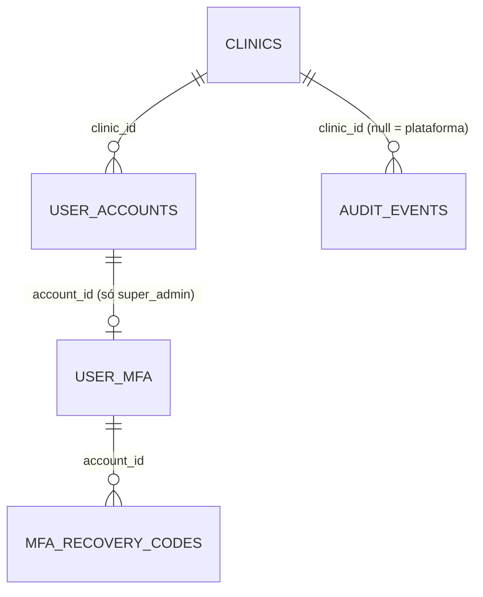

# Portal do Super Admin: provisionamento e ciclo de vida de clínicas

> Plan this with **tlc-plan**.
> Decisions below carry the literal shape - copy them, do not re-derive them.

## Situation

- Project: in active construction — revisão pré-produção ([#183](https://github.com/KalleoPinheiro/vitta-flow/issues/183)); nada em produção.
- Decision: committed pelo [ADR-001](../docs/adr/001-multi-tenancy.md) ("toda empresa nova é criada manualmente pelo Super Admin" até a Fase 3). O **como** estava aberto em [#214](https://github.com/KalleoPinheiro/vitta-flow/issues/214) e foi fechado nesta discovery com @KalleoPinheiro em 2026-09-27.
- In flight: [#214](https://github.com/KalleoPinheiro/vitta-flow/issues/214) (decisão mono × multi — respondida aqui), [#210](https://github.com/KalleoPinheiro/vitta-flow/issues/210) (auditoria sem empresa cai na clínica legada — item 1 e 4 resolvidos aqui), [#211](https://github.com/KalleoPinheiro/vitta-flow/issues/211) (`partners.email` global — entra como bloco pré-requisito), [#215](https://github.com/KalleoPinheiro/vitta-flow/issues/215) (permissões dentro da clínica — fora deste escopo).
- At stake: costly. Dado de saúde sob LGPD: erro de escopo grava ou mostra dado na empresa errada, e corrigir depois do go-live é migrar dado real. O super_admin controla todas as clínicas: comprometer a conta dele compromete a plataforma.

## Problem

Construção. O ADR-001 e o ADR-003 prometeram um papel de sistema que cria e administra empresas; o mecanismo nunca foi construído:

- Não existe criação de clínica: `DrizzleClinicRepository.create` só é chamado por fixture de teste. A segunda clínica só nasce por `INSERT` no banco de produção.
- O super_admin não tem área própria. Ele usa a área da equipe com `clinicId = null`: lê tudo cross-empresa (inclusive prontuário) e grava tudo na `legacy-clinic` via `writeClinicId` (`src/lib/auth/tenant-scope.ts:41`), sem aviso.
- Eventos sem empresa (login com falha, ações do super_admin) caem na `legacy-clinic` (`resolveActor`, `src/lib/audit.ts:85`): o admin da primeira clínica veria tentativas de login de todas as outras, com os e-mails digitados.
- Não há como suspender uma clínica.
- A conta mais crítica do sistema não tem segundo fator nem caminho de recuperação (ADR-004 aceita "intervenção direta no banco"), e a matriz `PROVISIONING_MATRIX.super_admin` permite criar outra conta `super_admin` ligada a uma clínica, o que o índice `uq_user_accounts_single_system_account` não barra.
- Qualquer `company_admin` pode disparar `POST /api/admin/taxonomy/import`, que grava o catálogo **global** de taxonomias.

**Por que agora:** o go-live terá uma clínica, e outras já estão no radar. Corrigir escopo e auditoria antes do go-live é mudar código; depois, é migrar dado de saúde em produção.

## Evidence

- Clínicas no go-live: 1; outras "no radar", sem data — @KalleoPinheiro, 2026-09-27.
- Operadores da plataforma: 1 (o próprio dono do produto, técnico) — @KalleoPinheiro, 2026-09-27.
- Fusos das clínicas no radar: todas no horário de Brasília — @KalleoPinheiro, 2026-09-27.
- Tempo de implantação de uma clínica hoje: não mensurável — não existe caminho além de SQL manual.

## Journey

Operador único: o super_admin (dono do produto). Estados confirmados:

1. **Instalação nova.** `POST /api/auth/bootstrap` cria o super_admin (inalterado) → convite por e-mail → define senha → **primeiro login exige cadastrar o segundo fator** antes de qualquer outra tela → códigos de recuperação exibidos uma única vez → `/plataforma`.
2. **Login do super_admin.** Senha → código do autenticador (ou código de recuperação) → `/plataforma`. Sem o segundo fator não existe sessão de super_admin.
3. **Criar clínica.** Nome, CNPJ, telefone/WhatsApp, e-mail de contato e e-mail do primeiro admin, todos obrigatórios; responsável técnico (nome + COREN) opcional. Ao salvar, a clínica nasce `active` e o primeiro `company_admin` recebe o convite.
4. **Convite do admin expirou (24 h) ou o e-mail estava errado.** A clínica aparece como "aguardando primeiro acesso"; o super_admin reenvia o convite, ou desativa a conta e convida outro e-mail.
5. **Admin da clínica saiu.** O super_admin convida o novo admin e depois desativa o antigo (a regra "não desativar o último `company_admin` ativo" continua valendo).
6. **Editar dados cadastrais** (nome, CNPJ, contato, responsável técnico): super_admin pela plataforma e `company_admin` pela tela de Configurações. A ação do super_admin aparece na auditoria da clínica.
7. **Suspender.** Todas as contas da clínica (equipe, paciente, parceiro) perdem a sessão em até 60 s e não conseguem entrar; lembretes param; os dados ficam intactos. O super_admin continua vendo o cadastro e pode reativar.
8. **Reativar.** As contas voltam a entrar (com novo login); lembretes voltam no próximo ciclo.
9. **Super_admin abre uma tela da clínica** (`/agenda`, `/pacientes`, …) → redirecionado para `/plataforma`; API responde `403`.
10. **`company_admin` tenta abrir `/plataforma`** → redireciona para `/` (o mesmo vale para `atendente` e `profissional`; paciente e parceiro vão a `/portal`); API `403`.
11. **Perdeu o celular do autenticador** → entra com código de recuperação e recadastra o segundo fator.
12. **Perdeu tudo** (senha, e-mail ou autenticador e códigos) → procedimento de emergência no servidor (`scripts/recover-super-admin.ts`), documentado no runbook.

## Verdict

build — sem esta peça a segunda clínica só nasce por SQL em produção, o super_admin grava na clínica errada e lê prontuário que não deveria, e a auditoria vaza eventos entre empresas; o custo de fazer agora é código, o de fazer depois é migrar dado de saúde real. Confirmed by @KalleoPinheiro, 2026-09-27.

Cheaper paths considered:
- Scripts de linha de comando no lugar da tela — descartado: suspender, reenviar convite, editar cadastro e auditoria passariam todos a exigir acesso ao servidor de produção, o que aumenta a superfície que o risco 2 quer reduzir. Mantido só para a recuperação de emergência (risco 3), que por natureza roda fora do login.
- Implantar as primeiras clínicas à mão — descartado: é `INSERT` com dado de saúde em produção, e o dono decidiu ir ao go-live preparado para várias clínicas.
- Comprar pronto — não se aplica: é o controle de acesso do próprio produto.

## Success

- Worked if: a segunda clínica é implantada, da criação ao primeiro login do admin, sem nenhum comando no banco nem acesso ao servidor — na implantação da segunda clínica.
- Early signal: a clínica do go-live já é cadastrada e ganha seu admin pelo fluxo `/plataforma`, sem nenhuma tela ou e-mail mostrando "Clínica legada". Se for preciso SQL para ela, a aposta está falhando.
- Review: implantação da segunda clínica — @KalleoPinheiro.

## Boundary

In:
- Área `/plataforma` exclusiva do super_admin: listar, criar e editar dados cadastrais de clínicas; convidar, reenviar convite, desativar e reativar `company_admin`.
- Suspender e reativar clínica.
- Super_admin sem acesso clínico nem operacional às clínicas.
- Proteção do super_admin: só um, criado só pelo bootstrap; segundo fator obrigatório; recuperação de emergência.
- Auditoria: trilha da plataforma só para o super_admin; ações do super_admin numa clínica também na trilha dela ([#210](https://github.com/KalleoPinheiro/vitta-flow/issues/210) itens 1 e 4).
- Importação do catálogo global de taxonomias passa a ser ato de plataforma.
- `partners.email` único por empresa ([#211](https://github.com/KalleoPinheiro/vitta-flow/issues/211)), pré-requisito da segunda clínica.

Out:
- Configurações operacionais da clínica (grade, feriados, cancelamento, lembretes, integrações) — continuam do `company_admin`.
- Exclusão de clínica — abandonada pelo dono: prontuário tem guarda protegida por lei.
- Fuso por clínica — todas as clínicas no radar estão no horário de Brasília.
- Self-service de clínica e cobrança — Fase 3 do ADR-001.
- Retenção, índice composto e paginação por cursor da trilha de auditoria ([#210](https://github.com/KalleoPinheiro/vitta-flow/issues/210) itens 2 e 3).
- Quem altera grade/feriados/taxa dentro da clínica ([#215](https://github.com/KalleoPinheiro/vitta-flow/issues/215)).
- Segundo fator para outros papéis.
- Estado por empresa em cache de processo (fato 6 da [#214](https://github.com/KalleoPinheiro/vitta-flow/issues/214)) — já resolvido: `src/lib/report-cache.ts:24` e `src/infrastructure/container.ts:267` usam a clínica na chave; o rate limit foi resolvido na #201.

## Prior art

- TOTP (RFC 6238) — padrão aberto, funciona com qualquer app autenticador e se implementa com HMAC do `node:crypto`, sem dependência nova (o repositório já recusou dependência nativa por superfície de build, STATE.md AD sobre fotos).
- Códigos de recuperação de uso único, exibidos uma vez e guardados com hash — padrão dos consoles que exigem segundo fator; é o que evita o "perdi o celular" virar intervenção no banco.
- Passkeys/WebAuthn resistem a phishing, mas exigem biblioteca e fluxo de registro por dispositivo; a condição que as justificaria (vários operadores, exigência de conformidade) não existe aqui.
- Não verificado na web nesta sessão; o restante vem do próprio repositório.

## Shape

A aposta: o super_admin vira **operador da plataforma** dentro do mesmo app, numa família de rota própria (`platform`) que só ele acessa, e sai de todas as famílias da clínica. Clínica ganha contato e estado (`active`/`suspended`); a suspensão reaproveita a revogação por consulta de 60 s do ADR-005. O segundo fator é TOTP próprio, sem dependência. Mudar depois para um app separado custa mover rotas e cookie, não dados.

### Adds

- Colunas em `clinics`: `contact_phone text`, `contact_email text`, `status text not null default 'active'` (`'active' | 'suspended'`), `status_changed_at timestamptz`, `status_changed_by text`.
- Índice único `uq_clinics_cnpj` em `clinics(cnpj)` onde `cnpj is not null`.
- Tabela `user_mfa` (`account_id` PK → `user_accounts.id`, `totp_secret` cifrado com a chave de dados do ADR-006, `enrolled_at`, `last_used_step integer` para impedir reuso do mesmo código).
- Tabela `mfa_recovery_codes` (`id`, `account_id`, `code_hash` scrypt, `used_at`).
- Check constraint em `user_accounts`: `(role = 'super_admin') = (clinic_id IS NULL)`.
- Família de rota `platform` em `src/lib/auth/route-family.ts`: prefixos `/api/platform`, `/plataforma`; `FAMILY_ALLOWED_ROLES.platform = ['super_admin']`.
- Rotas: `GET/POST /api/platform/clinics`, `GET/PATCH /api/platform/clinics/[id]`, `POST /api/platform/clinics/[id]/suspend`, `POST /api/platform/clinics/[id]/reactivate`, `GET/POST /api/platform/clinics/[id]/admins`, `PATCH /api/platform/clinics/[id]/admins/[accountId]` (reenviar convite, desativar, reativar), `GET /api/platform/audit`, `POST /api/platform/taxonomy/import`.
- Rotas de segundo fator: `POST /api/auth/mfa/enroll` (gera segredo, devolve chave e URI `otpauth://`), `POST /api/auth/mfa/verify` (confirma código e emite a sessão; no cadastro, devolve os 10 códigos de recuperação uma única vez).
- Token de login pendente assinado (HMAC com `AUTH_SECRET`, validade 5 min, finalidade `mfa`), entregue pelo login do super_admin no lugar da sessão.
- Casos de uso em `src/application/platform/`: `CreateClinic` (clínica + primeiro `company_admin` + convite, numa transação para a clínica e a conta), `UpdateClinicInfo`, `SuspendClinic`, `ReactivateClinic`, `ManageClinicAdmins`.
- Domínio: `src/domain/auth/totp.ts` (RFC 6238, SHA-1, 6 dígitos, passo de 30 s, janela ±1).
- Telas em `src/app/plataforma/`: lista de clínicas (estado, admin pendente/ativo), nova clínica, detalhe da clínica (cadastro, admins, suspender/reativar), trilha da plataforma, cadastro do segundo fator. Só componentes `@still-void/ui`.
- `scripts/recover-super-admin.ts` (roda no servidor com `DATABASE_URL`): remove o segundo fator e os códigos, troca o e-mail se pedido, incrementa `session_version`, grava auditoria de plataforma e imprime o link de definir senha.
- ADR-007 "Super Admin como operador da plataforma", emendando ADR-003 (sem acesso clínico) e ADR-004 (recuperação por script em vez de "intervenção no banco").

### Changes

- `PROVISIONING_MATRIX.super_admin` → remove `'super_admin'`; `CreateAccount` recusa `role: 'super_admin'` sempre.
- `FAMILY_ALLOWED_ROLES` → `super_admin` sai de `clinical`, `operational`, `administrative` e `professional_self`.
- Layout `src/app/(staff)/layout.tsx` → super_admin é redirecionado para `/plataforma`.
- `POST /api/auth/login` → para `super_admin`, devolve `{ mfaRequired: true, pendingToken }` (ou `mfaEnrollmentRequired`) em vez da sessão; login de conta de clínica `suspended` é negado.
- `isSessionRevoked` / `lookupAccountStatus` (`src/lib/auth/staff-revocation.ts`) → o status passa a incluir o estado da clínica; clínica `suspended` revoga como conta inativa.
- Job de lembretes (`send-reminders.ts`) → ignora clínicas `suspended`.
- `POST /api/accounts` → remove o parâmetro `clinicId` e o caminho do super_admin (que passa a usar `/api/platform/clinics/[id]/admins`).
- `PUT /api/settings/clinic-info` → só `company_admin`; ganha `contactPhone` e `contactEmail`.
- `audit_events.clinic_id` → nullable; `null` = evento de plataforma. `resolveActor` deixa de usar `LEGACY_CLINIC_ID`; ação do super_admin sobre uma clínica grava `clinic_id` da clínica-alvo.
- `DrizzleAuditEventRepository` → montado com `clinicId` no container como os demais repositórios; a leitura de plataforma usa `clinic_id is null or actor_role = 'super_admin'`.
- `POST /api/admin/taxonomy/import` → removida (substituída por `/api/platform/taxonomy/import`).
- `partners.email` → índice único `(clinic_id, email)` no lugar do global ([#211](https://github.com/KalleoPinheiro/vitta-flow/issues/211)).
- `docs/domains/acesso/README.md` → ACE-RN-10 reescrita (super_admin sem acesso a dado de clínica), novas regras de plataforma, suspensão e segundo fator; papel `super_admin` na tabela de papéis.
- `docs/engineering/producao.md` → procedimento de recuperação do super_admin.

### Leaves

- Bootstrap (`POST /api/auth/bootstrap`) — continua o único jeito de nascer um super_admin.
- `writeClinicId` com fallback para `legacy-clinic` — continua só para o modo aberto de desenvolvimento; nenhuma rota do super_admin passa por ele.
- Exclusão de clínica, fuso por clínica, self-service, retenção de auditoria, #215 — ver Boundary Out.

A forma mais pesada — um app ou subdomínio separado para a plataforma, com cookie e deploy próprios — só compensa com vários operadores, exigência de conformidade ou funções de plataforma crescendo (cobrança); hoje há um operador e nada disso no roadmap. O que a forma leve **não** sobrevive: um segundo operador com permissões diferentes (exigiria papéis de plataforma) e exigência de MFA resistente a phishing (exigiria passkeys); qualquer um dos dois força revisar a família `platform` e o fator.

Also in the field, for perspective and not as candidates:
- Seletor de empresa ("entrar como a clínica") — removido pela decisão de o super_admin não operar dentro das clínicas.
- Segundo fator por código enviado por e-mail — removido: o e-mail é o mesmo canal do reset de senha, então não é um fator independente.

## Roadmap

| Block | Delivers | Clarity |
|---|---|---|
| B1 Contenção do super_admin | Só um super_admin possível (matriz + check constraint); super_admin fora das famílias da clínica e redirecionado para `/plataforma`; família `platform`; convite do primeiro `company_admin` (`POST /api/platform/clinics/[id]/admins`); importação de taxonomia movida; ADR-007. Tarefa: [`.tasks/b1-contencao-super-admin.md`](../.tasks/b1-contencao-super-admin.md) | clear |
| B2 Segundo fator do super_admin | Login em duas etapas, cadastro obrigatório no primeiro acesso, códigos de recuperação | clear |
| B3 Recuperação de emergência | `scripts/recover-super-admin.ts` + runbook em `producao.md` | clear |
| B4 Cadastro de clínicas | Colunas de contato, API e telas de listar/criar/editar clínica; listar admins, reenviar convite, desativar e reativar; tela de convite sobre a rota que o B1 criou | clear |
| B5 Suspensão e reativação | Estado da clínica, login negado, revogação em ≤ 60 s, lembretes pausados | clear |
| B6 Auditoria de plataforma | `audit_events.clinic_id` nullable, trilha de plataforma, repositório escopado ([#210](https://github.com/KalleoPinheiro/vitta-flow/issues/210) itens 1 e 4) | clear |
| B7 Parceiro por empresa | `partners.email` único por `(clinic_id, email)` ([#211](https://github.com/KalleoPinheiro/vitta-flow/issues/211)) | clear |

Ordem: B1 primeiro (cria a família `platform` que B4–B6 usam). O convite do primeiro admin saiu do B4 para o B1: sem ele, depois que o super_admin deixa as rotas da clínica, não existe caminho para criar um `company_admin`, e a suíte E2E (que hoje roda como super_admin) fica sem admin; B2 e B3 juntos; B4 → B5; B6 e B7 independentes. Tudo antes do go-live; B7 no máximo antes da segunda clínica.

## Decisions

| Decision | Choice | Why this | Alternative, and what would make it win | Reversibility |
|---|---|---|---|---|
| Onde fica a área do super_admin | Mesmo app, família de rota `platform` (`/plataforma`, `/api/platform/**`), `FAMILY_ALLOWED_ROLES.platform = ['super_admin']` | Reaproveita as duas camadas do ADR-002 sem deploy novo | App/subdomínio separado — vence com vários operadores ou exigência de conformidade | reversible |
| Alcance do super_admin | Cadastro da clínica + gestão de `company_admin` + suspender/reativar; `super_admin` removido de `clinical`, `operational`, `administrative`, `professional_self` | Decisão do dono (opção b): operação do dia a dia é da clínica; minimização LGPD | Acesso excepcional justificado e visível à clínica — vence se o suporte precisar ler dado clínico | costly |
| Unicidade do super_admin | `PROVISIONING_MATRIX.super_admin` sem `'super_admin'`; check `(role = 'super_admin') = (clinic_id IS NULL)` + índice já existente | Fecha o caminho de uma conta `super_admin` ligada a clínica | — | reversible |
| Segundo fator | TOTP RFC 6238 (SHA-1, 6 dígitos, 30 s, janela ±1) em `node:crypto`; segredo cifrado (ADR-006); `last_used_step` impede reuso; obrigatório para `super_admin` | Padrão aberto, sem dependência, qualquer app autenticador | Passkeys/WebAuthn — vence se phishing do operador virar a ameaça principal ou houver exigência de conformidade | costly |
| Login com segundo fator | Senha → token pendente HMAC (`AUTH_SECRET`, 5 min, finalidade `mfa`) → `POST /api/auth/mfa/verify` emite a sessão; sem fator cadastrado → cadastro obrigatório antes da sessão | Nunca existe sessão de super_admin sem segundo fator | Sessão parcial com flag — descartado: toda rota teria de checar a flag | reversible |
| Códigos de recuperação | 10 códigos de uso único, hash scrypt, exibidos uma vez no cadastro; usar um deles permite recadastrar o fator | Cobre "perdi o celular" sem acesso ao servidor | — | reversible |
| Recuperação total | `scripts/recover-super-admin.ts` no servidor: limpa fator e códigos, troca e-mail opcional, `session_version + 1`, auditoria de plataforma, imprime link de definir senha | Quem tem o servidor já tem o banco; não abre porta nova no login | Rota de recuperação com segredo de deploy — descartado: mais uma porta pública | reversible |
| Estado da clínica | `clinics.status text not null default 'active'`, valores `'active' | 'suspended'`; `status_changed_at`, `status_changed_by` | Suspensão reversível mantendo todos os dados | — | costly |
| Efeito da suspensão | Login negado; `isSessionRevoked` trata clínica `suspended` como conta inativa (≤ 60 s, ADR-005); lembretes ignoram a clínica; vale para equipe, paciente e parceiro | Reaproveita a revogação existente | — | reversible |
| Dados obrigatórios na criação | `name`, `cnpj`, `contact_phone`, `contact_email`, e-mail do primeiro admin; `professional_name`/`professional_registry` opcionais | Decisão do dono (pergunta 9): nenhuma clínica nasce sem nome real ou contato | Trava de lembretes por dado incompleto — desnecessária com os campos obrigatórios | reversible |
| Clínica do go-live (`legacy-clinic`) | Aparece em `/plataforma` como "cadastro incompleto"; convidar o primeiro admin exige nome, CNPJ, telefone e e-mail preenchidos | Sem admin não há paciente nem lembrete, então nada sai como "Clínica legada" | Migração que renomeia a clínica — descartado: o nome real só o operador sabe | reversible |
| Auditoria sem empresa | `audit_events.clinic_id` nullable (`null` = plataforma); ação do super_admin numa clínica grava a clínica-alvo; trilha de plataforma = `clinic_id is null or actor_role = 'super_admin'`, só para o super_admin | Decisão do dono (pergunta 10); elimina o vazamento de logins entre empresas | Tabela `platform_audit_events` separada — vence se a trilha de plataforma precisar de retenção diferente | costly |
| Catálogo de taxonomias | `POST /api/platform/taxonomy/import`, só super_admin; remove `/api/admin/taxonomy/import` | Grava dado global, que atinge todas as clínicas | — | reversible |
| Parceiro por empresa | Índice único `(clinic_id, email)` em `partners`; mensagem "Já existe parceiro com este e-mail" | Critérios já fechados na #211 | — | reversible |

## Needs an RFC

1. Retenção da trilha de auditoria ([#210](https://github.com/KalleoPinheiro/vitta-flow/issues/210) item 2) — decisão jurídica; bloqueia a rotina de expurgo e o particionamento, não este escopo.

## Open

1. CNPJ repetido entre clínicas — default: recusado (`uq_clinics_cnpj`); filiais têm CNPJ próprio.
2. Mensagem ao entrar numa clínica suspensa — default: "O acesso desta clínica está suspenso. Fale com o responsável pela clínica." (equipe) e a mesma com o contato da clínica (portal).
3. QR code no cadastro do segundo fator — default: exibir a chave em texto e o link `otpauth://`; QR fica para depois se o cadastro manual incomodar.
4. Eventos antigos atribuídos à `legacy-clinic` em ambientes de teste — default: sem migração retroativa (nada em produção).
5. Super_admin desativando o último `company_admin` — default: mantém a regra; convida o novo antes de desativar o antigo.

## Sources

- [#214](https://github.com/KalleoPinheiro/vitta-flow/issues/214), [#210](https://github.com/KalleoPinheiro/vitta-flow/issues/210), [#211](https://github.com/KalleoPinheiro/vitta-flow/issues/211), [#215](https://github.com/KalleoPinheiro/vitta-flow/issues/215) — decisões pendentes que esta discovery responde.
- [ADR-001](../docs/adr/001-multi-tenancy.md) — compromisso "empresa nova criada pelo Super Admin".
- [ADR-003](../docs/adr/003-modelo-de-papeis-multi-empresa.md), [ADR-004](../docs/adr/004-remocao-google-oauth-autenticacao.md), [ADR-005](../docs/adr/005-revogacao-de-sessao-por-versao.md), [ADR-006](../docs/adr/006-chave-de-dados-clinicos.md) — emendados ou reaproveitados.
- `src/lib/auth/tenant-scope.ts:41`, `src/lib/audit.ts:85`, `src/domain/auth/role-hierarchy.ts:10`, `src/lib/auth/route-family.ts:125`, `src/lib/auth/staff-revocation.ts`, `src/app/api/admin/taxonomy/import/route.ts` — estado atual lido nesta discovery.
- Respostas de @KalleoPinheiro, 2026-09-27: go-live com 1 clínica e sistema pronto para várias; único super_admin; cobrir os três riscos; sem acesso clínico; opção (b); suspender/reativar e exclusão abandonada; fuso único; dados obrigatórios e auditoria conforme recomendação.
