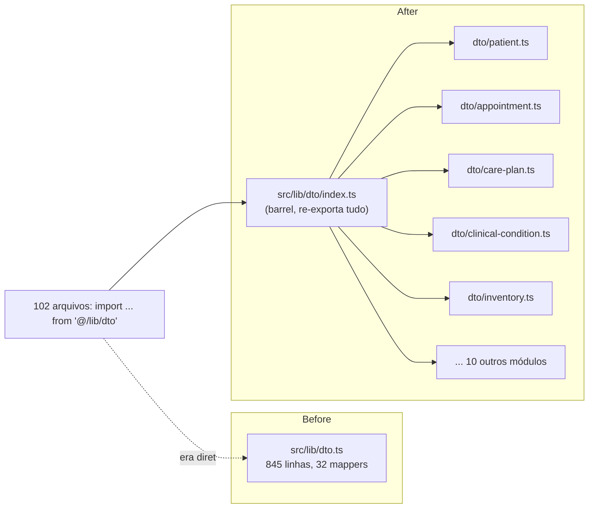

# Split de src/lib/dto.ts por aggregate — Design

**Spec**: `.specs/features/lib-dto-split/spec.md`
**Status**: Approved (decisão de lib/ vs domain/ já confirmada com o usuário na Specify)

---

## Architecture Overview

Pure structural split: um arquivo vira um diretório com um módulo por aggregate, mais um barrel que preserva o caminho de import público (`@/lib/dto`). Nenhuma lógica muda — só onde o código mora.

`@/lib/dto` como especificador de módulo resolve tanto pra `dto.ts` quanto pra `dto/index.ts` — trocar o arquivo por um diretório com `index.ts` é transparente pro resolver do TypeScript/bundler, então os 102 consumidores não mudam uma linha.

---

## Code Reuse Analysis

Nada a reusar de fora — é puro corte-e-cola de código já existente, preservando assinaturas, comentários e tipos.

### Integration Points

| System | Integration Method |
| --- | --- |
| 102 consumidores de `@/lib/dto` | Nenhuma mudança — o barrel resolve no mesmo caminho |
| `tests/lib/dto.test.ts` (22KB, testa os mappers) | Continua importando de `@/lib/dto`; não precisa mudar (mas pode ser dividido em paralelo — fora de escopo, ver spec) |

---

## Components (módulos novos sob `src/lib/dto/`)

| Arquivo | Conteúdo | Por quê agrupado assim |
| --- | --- | --- |
| `patient.ts` | `PatientDto`/`toPatientDto`, `PortalPatientProfileDto`/`toPortalPatientProfileDto`, `ReferredPatientSummaryDto`/`toReferredPatientSummaryDto` | Todos vistas do aggregate Patient (completa + 2 projeções de portal) |
| `partner.ts` | `PartnerDto`/`toPartnerDto` | Aggregate próprio |
| `appointment.ts` | `AppointmentDto`/`toAppointmentDto`, `PortalAppointmentDto`/`toPortalAppointmentDto` | View completa + projeção de portal do mesmo aggregate |
| `billing.ts` | `InvoiceDto`/`toInvoiceDto` | Aggregate próprio (Invoice) |
| `anamnesis.ts` | `AnamnesisDto`/`toAnamnesisDto` | Entidade própria no domínio (Anamnesis) |
| `evolution-note.ts` | `EvolutionNoteDto`/`toEvolutionNoteDto` | Entidade própria (Evolution Note, formato SOAP) |
| `clinical-condition.ts` | `ConditionDto`/`toConditionDto`, `PortalConditionDto`/`toPortalConditionDto`, `AssessmentDto`/`toAssessmentDto`, `PortalAssessmentDto`/`toPortalAssessmentDto`, `ConditionPhotoDto`/`toConditionPhotoDto`, `TriagePhotoDto` (sem mapper) | Cluster de Clinical Condition: condição + avaliações + fotos + fila de triagem, todos girando em torno do mesmo aggregate root |
| `taxonomy.ts` | `NursingDiagnosisDto`/`toNursingDiagnosisDto`, `NursingOutcomeDto`/`toNursingOutcomeDto`, `NursingInterventionDto`/`toNursingInterventionDto` | Catálogo NANDA/NOC/NIC — mesma origem (taxonomia importada) |
| `care-plan.ts` | `CarePlanDto`, `CarePlanDiagnosisDto`, `OutcomeEvaluationDto`, `CarePlanOutcomeDto`, `InterventionRecordDto`, `CarePlanInterventionDto`, `CarePlanDetailDto`, `CarePlanCatalogLookup` + todos os `to*` | Cluster fortemente acoplado: `toCarePlanDetailDto` compõe diretamente os outros 4 mappers deste arquivo — separar geraria import circular ou fragmentação artificial |
| `inventory.ts` | `SupplyDto`/`toSupplyDto`, `StockMovementDto`/`toStockMovementDto` | Cluster de estoque (Supply + seu ledger de movimentos) |
| `followup.ts` | `FollowUpDto`/`toFollowUpDto` | Aggregate próprio |
| `audit.ts` | `AuditEventDto`/`toAuditEventDto` | Aggregate próprio |
| `professional.ts` | `ProfessionalDto`/`toProfessionalDto` | Aggregate próprio |
| `procedure.ts` | `ProcedureDto`/`toProcedureDto` | Aggregate próprio (catálogo) |
| `account.ts` | `UserAccountDto`/`toUserAccountDto` | Aggregate próprio (conta de acesso) |
| `clinic.ts` | `ClinicInfoDto`/`toClinicInfoDto` | Aggregate próprio (dados cadastrais da clínica) |
| `staff.ts` | `SidebarIdentityDto` (sem mapper), `CalendarIntegrationStatusDto` (sem mapper) | Sem aggregate de domínio próprio — são projeções de UI da área staff (sidebar, configurações); agrupados por não terem outro lar natural |
| `index.ts` | `export * from './<cada arquivo acima>'` | Barrel de compatibilidade — único arquivo que os 102 consumidores continuam enxergando como `@/lib/dto` |

17 módulos + 1 barrel = 18 arquivos, substituindo o único `dto.ts` de 845 linhas.

- **Dependencies**: cada módulo importa só os tipos de domínio que já importava (`@/domain/**`), nenhum importa de outro módulo `dto/*` — exceto dentro de `care-plan.ts`, que é intencionalmente um único arquivo por causa do acoplamento citado.
- **Reuses**: 100% do código existente, apenas realocado.

---

## Data Models

Nenhum novo — os 30 `interface`s e `type`s existentes são movidos verbatim.

---

## Error Handling Strategy

N/A — nenhuma lógica de erro nova ou alterada.

---

## Risks & Concerns

| Concern | Location (file:line) | Impact | Mitigation |
| --- | --- | --- | --- |
| `tests/lib/dto.test.ts` (22KB) testa tudo num arquivo só, espelhando o grab-bag original | `tests/lib/dto.test.ts` | Baixo — não é o escopo desta issue (spec explicitamente marca "dividir os testes" como fora de escopo), mas fica menos óbvio qual teste cobre qual módulo novo | Nenhuma ação nesta feature; candidato a follow-up separado se a dor se repetir |
| Import circular entre módulos novos | qualquer `dto/*.ts` novo | Alto se acontecer — quebra o build | Mitigado pelo agrupamento: `care-plan.ts` é o único cluster com composição interna forte, e fica como um arquivo só; nenhum outro módulo referencia tipo de outro módulo `dto/*` |
| Barrel `export *` esconder qual símbolo veio de qual arquivo em ferramentas de "find references" | `src/lib/dto/index.ts` | Baixo, cosmético — IDEs modernos seguem o export até a origem real | Aceito; é o preço da compatibilidade total de import, decisão explícita da spec |

---

## Tech Decisions

| Decision | Choice | Rationale |
| --- | --- | --- |
| Barrel vs. migrar os 102 imports | Barrel (`dto/index.ts` com `export *`) | Migrar 102 call sites multiplicaria o risco do PR por 20x pra um ganho de locality que o barrel já entrega; migração incremental fica pro futuro (fora de escopo, já registrado na spec) |
| Um arquivo por aggregate vs. um por "camada" (ex.: todos os portal DTOs juntos) | Por aggregate, com a view de portal ao lado da view completa no mesmo arquivo | Editar o aggregate Patient deve tocar um lugar só, incluindo suas projeções; espalhar as views de portal por um arquivo "portal.ts" à parte recriaria o mesmo problema de coesão que a issue #150 já rejeitou como abstração especulativa |
| `care-plan.ts` não é dividido em diagnosis/outcome/intervention separados | Um arquivo só pro cluster inteiro | `toCarePlanDetailDto` (o mapper mais profundo do domínio) compõe os outros 4 diretamente — três arquivos que só se importam entre si não ganham locality real, só criam indireção |
