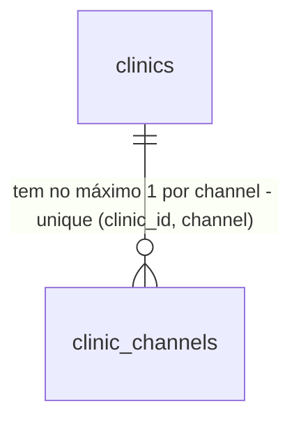

# C1 — Canal de e-mail por clínica

> Build this with **tlc-implement**.
> Every criterion below becomes a check with a proof, referenced by its number. Nothing under
> `Unresolved` gets settled while building.

## Intent

Hoje todo e-mail de todas as clínicas sai de uma conta Resend única do operador. O container monta
um gateway global, `email: buildEmailGateway()` em `src/infrastructure/container.ts:416`, que lê
`RESEND_API_KEY`/`EMAIL_FROM`, e em produção o boot **lança** sem essas variáveis
(`src/infrastructure/email/resend-email-gateway.ts`, `buildEmailGateway`). O operador paga o
tráfego de todas as clínicas, o remetente nunca é o da clínica, e o teto grátis (100/dia) estoura
entre a 3ª e a 4ª clínica, com 3+ clínicas esperadas em 6 meses (`.design/canal-por-clinica.md`,
Evidence).

Com esta task, cada clínica pode ter uma linha de canal de e-mail própria, com a chave cifrada. O
`EmailGateway` de um escopo de clínica passa a sair só por esse canal. O escopo de plataforma
(`systemScope()`) sai pela chave da plataforma, que fica opcional. Sem canal, o gateway é o nulo,
inclusive em produção.

11 critérios em 3 fatias · 3 portas sem volta (1 migração) · 1 em aberto, 0 bloqueiam

## Criteria

### Canal da clínica guardado com segredo cifrado

1. Quando `ClinicChannelRepository.save` grava um canal `email`/`resend` com `apiKey = 're_abc123XYZ9'`, então a linha em `clinic_channels` tem `encrypted_secret` diferente de `'re_abc123XYZ9'`, `secret_last4 = 'XYZ9'`, e `findByClinic(clinicId, 'email')` devolve o canal com a chave decifrada igual à original.
2. Sempre, o banco recusa uma segunda linha com o mesmo `(clinic_id, channel)` (índice único `uq_clinic_channels_clinic_channel`), um `channel` fora de `('email')` e um `last_status` fora de `('ok','failed')` (SQLSTATE `23505`/`23514`).
3. Sempre, o repositório da clínica A não lê nem grava o canal da clínica B: `findByClinic` no escopo A, com a linha de B presente, devolve `null`.

### Gateway resolvido pelo escopo

4. Dado que a clínica A tem canal `email` salvo, quando `getRepositories(clinicScope(A)).email.send(...)` é chamado, então o POST vai para a API do Resend com `Authorization: Bearer <chave de A>` e `from = <sender de A>`, e `email.enabled === true`.
5. Dado que a clínica B não tem canal e que `RESEND_API_KEY`/`EMAIL_FROM` estão definidas, quando `getRepositories(clinicScope(B)).email` é montado, então `enabled === false` e `send` não faz nenhuma chamada HTTP.
6. Dadas `RESEND_API_KEY`/`EMAIL_FROM` definidas, quando `getRepositories(systemScope()).email.send(...)` é chamado, então sai pela chave da plataforma; sem elas, `enabled === false`.
7. Sempre, duas clínicas com canais diferentes enviam cada uma pela própria chave na mesma instância do processo, em qualquer ordem de chamada (nada de cache global de credencial, issue #74).
8. Se o segredo gravado não decifra (ex.: `DATA_ENCRYPTION_KEY` trocada sem `_PREVIOUS`), então o gateway da clínica fica `enabled === false` e um `logError` registra o id da clínica, sem a chave e sem o texto cifrado.

### E-mail da plataforma opcional

9. Dado `NODE_ENV=production` sem `RESEND_API_KEY`, quando os serviços são montados, então nada lança e `systemScope().email.enabled === false`.
10. Sempre, com `NODE_ENV=production` e canal desativado, o log do gateway nulo não contém o link de senha (comportamento atual de `NullEmailGateway`, mantido).
11. Quando o ADR-011 é publicado, então `docs/adr/011-canal-de-comunicacao-por-clinica.md` existe com status `aceito`, e o ADR-004 aponta para ele na linha sobre o provedor de e-mail transacional.

## Out of scope

- Trocar os envios (convite, redefinição, lembretes) para o canal da clínica — C2.
- Tela e API para configurar o canal — C3.
- Status na `/plataforma` — C4.
- WhatsApp e outros provedores — design doc, Boundary Out.

## Observable

`None - no user-facing surface` (a superfície do canal é a C3).

## Swept

- validation: 2
- failure modes: 8
- idempotency and retry: n/a - nenhuma escrita exposta nesta task; o `save` é upsert por `(clinic_id, channel)` (2)
- authorization: 3
- concurrency and ordering: 7
- data lifecycle: n/a - `clinic_channels` nasce vazia; a remoção do canal chega na C3, e a clínica nunca é excluída (ADR-007)
- external-dependency failure: existing - `ResendEmailGateway.send` lança em não-2xx, com timeout de 10 s
- state transitions: n/a - sem ciclo de vida nesta task
- observability: 8

## Impact

| Front | What changes |
|---|---|
| domain | new term: `ClinicChannel` - credencial de um canal de comunicação de uma clínica (hoje só `email`/`resend`), em `src/domain/clinic/clinic-channel.ts` |
| domain | existing term: `Services.email` era o gateway global da plataforma; passa a ser o gateway do escopo. Hoje o usam `send-invite.ts`, `auth-token-flow.ts` (via rotas), `forgot-password`, `bootstrap` e `reminders/run` — o comportamento deles muda a partir daqui, e a C2 ajusta cada um |
| domain | existing term: `RESEND_API_KEY`/`EMAIL_FROM` eram obrigatórias em produção; passam a ser opcionais e só da plataforma — `.env.example`, `onboarding.md`, `producao.md` e `integrations/resend.md` |
| stored data | tabela nova, vazia; nada a migrar |
| tests | `tests/infrastructure/resend-email-gateway.test.ts` afirma o throw em produção — muda |

## Decided

| Decision | Shape | Alternative rejected |
|---|---|---|
| Tabela | `clinic_channels(id text pk, clinic_id text not null references clinics(id), channel text not null, provider text not null, sender text not null, encrypted_secret text not null, secret_last4 text not null, last_status text null, last_status_at timestamptz null, last_error text null, updated_at timestamptz not null, updated_by text not null)`; `uq_clinic_channels_clinic_channel unique (clinic_id, channel)`; `check (channel in ('email'))`; `check (last_status is null or last_status in ('ok','failed'))` | Colunas em `clinics` — não comporta um segundo canal (WhatsApp) sem outra migração |
| Cifra | `currentDataCipher().encrypt/decrypt` (ADR-006) | Chave derivada de `AUTH_SECRET` — o ADR-006 já substituiu esse caminho |
| Sem fallback | escopo de clínica nunca usa `RESEND_API_KEY` | Fallback para a plataforma — o dono decidiu que o custo é da clínica (2026-10-10) |
| E-mail da plataforma | `RESEND_API_KEY`/`EMAIL_FROM`, opcionais, só com `systemScope()` | Renomear para `PLATFORM_*` — fica como Open 1 |

## Relations

## Sources

- `.design/canal-por-clinica.md` — Decisions: Modelo de envio, Tabela, Segredo, Resolução do gateway, E-mail da plataforma, Boot em produção, ADR.
- `src/infrastructure/container.ts:221-296` — o molde `oauthCalendarGateway`/`calendarGatewayFor` que este gateway copia.
- Conversa de discovery, 2026-10-10 (sem endereço): "Desligado, inclusive E-mails de acesso etc, a plataforma passa a ser agnóstica e modular"; "Canal só da plataforma" para as contas da plataforma.

This task is the record of decision. If a linked document diverges, ask before building.

## Unresolved

| # | Kind | Question | Until answered |
|---|---|---|---|
| 1 | open | Renomear `RESEND_API_KEY`/`EMAIL_FROM` para `PLATFORM_*`? | Mantidos os nomes; docs dizem "só plataforma" |
