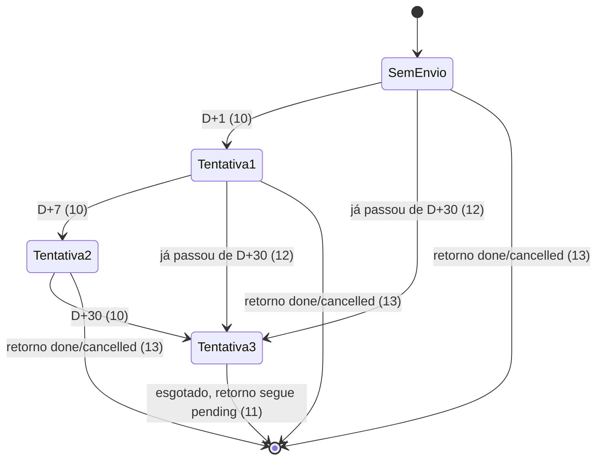
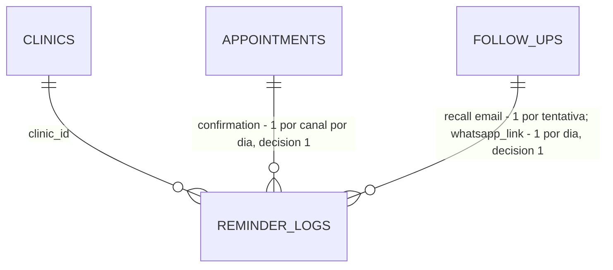

# Lembretes ao paciente sem custo de mensageria

> Build this with **tlc-implement**.
> Every criterion below becomes a check with a proof, referenced by its number. Nothing under
> `Unresolved` gets settled while building.

## Intent

Hoje o job de lembretes (`POST /api/reminders/run`) envia confirmação D-1 e recall como texto livre
pela Meta Cloud API. Fora da janela de 24 h que só o paciente abre, a Meta recusa essas mensagens
(N1). Com credenciais, então, todo lembrete conta como `failed` sem alarme; sem credenciais, o job
só faz dry-run. A correção prevista, templates *utility*, custa cerca de R$ 0,04–0,05 por mensagem
entregue (≈ R$ 20/mês por clínica, fontes secundárias) e exige uma conta Meta por clínica, contra a
premissa de mensageria a custo zero. Há ainda três falhas. O recall repete todo dia, sem fim (N2).
`dateKey` usa UTC enquanto o "amanhã" usa hora local. O job roda sem empresa (`systemScope()`),
grava todo log na clínica legada e corta os retornos vencidos em 500 (`MAX_ROWS`) (N3). Quem paga
é a primeira clínica: ela entra em produção sem nenhum lembrete chegando ao paciente.

Com esta task, o job manda por e-mail (Resend, já integrado) a confirmação D-1 e o recall, com
teto de três tentativas, separado por empresa e com o nome da clínica no texto. Na agenda e na
lista de retornos pendentes, a recepção ganha o botão **Enviar WhatsApp**, que abre
`wa.me` com a mensagem pronta no WhatsApp da própria clínica. Cada clique fica registrado, o que
mostra "enviado hoje às HH:MM" para outras recepcionistas e mede o uso do botão. O custo de
mensageria para a clínica é R$ 0.

24 critérios em 4 fatias · 2 portas sem volta (1 migração) · 10 abertas, das quais 2 bloqueiam e
1 bloqueia o go-live

## Criteria

### E-mail automático, por empresa

1. Dado paciente ativo com consulta `scheduled` amanhã (data local no fuso `TZ`), quando o job
   roda, então sai um e-mail para `patient.email` cujo corpo traz o primeiro nome, a data
   `dd/mm/aaaa`, a hora `HH:MM`, o nome da clínica dona da consulta e `<APP_URL>/portal` e não
   traz o procedimento. O job grava também um `reminder_log` com `kind='confirmation'`,
   `channel='email'`, `attempt=1` e o `clinic_id` da consulta.
2. Dado paciente ativo com retorno `pending` cuja tentativa cabe hoje (critério 10), quando o job
   roda, então sai um e-mail de recall com o primeiro nome, a data prevista `dd/mm/aaaa`, o nome
   da clínica e a chamada de agendamento pelo portal. O e-mail não traz o motivo do retorno. O job
   grava um `reminder_log` com `kind='recall'`, `channel='email'`, o `attempt` da tentativa e o
   `clinic_id` do retorno.
3. Se `APP_URL` está ausente ou não é URL http(s), o e-mail não traz link e usa a orientação de
   fallback. É a regra atual do COM-RN-02, estendida à confirmação.
4. Dado paciente inativo, quando o job roda, então nenhum e-mail sai para ele e o resumo conta
   `skipped`, como hoje.
5. Se a API do Resend lança erro no envio de um paciente, o resumo conta `failed` para ele,
   nenhum `reminder_log` é gravado e os demais lembretes do lote continuam sendo enviados.
6. Sem `RESEND_API_KEY`/`EMAIL_FROM` e fora de produção, quando o job roda, então nenhum e-mail
   sai: o conteúdo é logado, o resumo conta `skipped`, nenhum `reminder_log` é gravado e a resposta
   é 200 com `channelEnabled: false`.
7. Dadas duas empresas A e B com lembretes no mesmo dia, quando o job roda, então os e-mails dos
   pacientes de B trazem o nome de B e os logs levam o `clinic_id` de B. A resposta traz uma entrada
   de resumo por empresa (`clinicId`, `sent`, `skipped`, `failed`).
8. Se a leitura de uma empresa lança erro, as demais empresas são processadas no mesmo run.
9. Dada uma empresa com 501 retornos `pending` vencidos, todos com tentativa cabível hoje, quando
   o job roda, então saem 501 e-mails de recall; nada é cortado em `MAX_ROWS`.

### Cadência do recall

10. Dado retorno `pending` com `dueDate` no dia D, então o e-mail de recall sai apenas em D+1
    (`attempt=1`), D+7 (`attempt=2`) e D+30 (`attempt=3`), com dias contados no fuso `TZ`. Numa
    execução diária de D+0 a D+31, saem exatamente 3 e-mails.
11. Depois de gravado o `attempt=3` de um retorno, o job nunca mais envia recall por e-mail para
    ele, e o retorno continua `pending`.
12. Dado retorno que chega ao job já tendo passado de mais de uma marca sem envio (ex.: vencido há
    60 dias e sem log), quando o job roda, então sai uma única tentativa, a mais alta já cabível
    (`attempt=3`), e as anteriores não são enviadas depois.
13. Dado retorno marcado `done` ou `cancelled` entre duas tentativas, então nenhuma tentativa
    seguinte é enviada.
14. Quando o job roda duas vezes no mesmo dia, então nenhum paciente recebe um segundo e-mail de
    confirmação ou de recall naquele dia.
15. Dado o job rodando às 23:30 em `America/Sao_Paulo` (02:30 UTC do dia seguinte), então
    `sent_on` e a janela de "amanhã" usam a mesma data local. Nenhuma confirmação é enviada em
    dobro ou pulada na virada.

### Botão Enviar WhatsApp

16. Dada uma consulta `scheduled` aberta no detalhe da agenda (`appointment-detail.tsx`), o botão
    **Enviar WhatsApp** aparece. Para qualquer outro status, ele não aparece.
17. Quando a recepção clica **Enviar WhatsApp** numa consulta, então abre em nova aba
    `https://wa.me/55<dígitos do telefone>?text=<texto urlencoded>`. O texto traz primeiro nome,
    procedimento, data, hora e nome da clínica. Fica gravado um `reminder_log` com
    `kind='confirmation'`, `channel='whatsapp_link'` e o `clinic_id` da sessão.
18. Na lista de retornos pendentes da tela inicial da equipe (`(staff)/page.tsx`), cada retorno tem
    o botão **Enviar WhatsApp**. O clique abre o `wa.me` com o texto de recall (primeiro nome,
    motivo, data prevista, nome da clínica e chamada do portal) e grava `reminder_log` com
    `kind='recall'` e `channel='whatsapp_link'`.
19. Dado um clique registrado hoje para a consulta ou o retorno, quando qualquer usuário da equipe
    abre a mesma tela, então o botão mostra "enviado hoje às HH:MM" (horário do primeiro clique do
    dia, fuso `TZ`) e continua clicável.
20. Quando o botão é clicado de novo no mesmo dia, então o `wa.me` abre de novo e continua
    existindo um único `reminder_log` de `whatsapp_link` para aquela referência naquele dia.
21. Se duas requisições `POST /api/reminders/whatsapp-link` para a mesma referência chegam ao
    mesmo tempo, fica um único registro. Quem garante é o índice único da decisão 1 somado ao
    `onConflictDoNothing` já existente em `DrizzleReminderLogRepository.save`.
22. Um clique `whatsapp_link` registrado hoje não impede o e-mail automático da mesma referência:
    os canais são independentes.
23. `POST /api/reminders/whatsapp-link` responde 401 sem sessão, 403 para sessão de paciente ou
    parceiro, 400 com corpo fora de `{ kind: 'confirmation'|'recall', referenceId }` e 404 quando a
    referência não existe na empresa da sessão, inclusive quando existe em outra empresa.
24. Se o `POST` falha, o `wa.me` não abre e a tela mostra um toast `danger` com a mensagem de erro
    da API, no mesmo padrão de `resolveFollowUp`.

## States

Sequência de recall por e-mail de um retorno `pending`. O status do retorno não muda.

## Out of scope

- Templates da Meta (RM-14, entrega 1): passam para Later como opt-in por clínica. `MetaWhatsAppGateway` e `MessagingGateway` ficam no código, fora do job.
- Push no portal (PWA): not now, porque não há manifest nem service worker e o alcance é restrito.
- Webhook de entrada do WhatsApp e botões interativos: dependem da Meta.
- Webhook de bounce do Resend: serve para medição, não para entrega.
- Marcador visível de "recall esgotado" na UI (RM-14, D2, `recallExhaustedAt`): o design só diz que o retorno segue `pending`. Ver Unresolved 1.
- Remetente por clínica e tela de configuração de mensageria: ver Unresolved 6.
- Validar se o telefone tem WhatsApp: o próprio WhatsApp avisa, conforme o Journey do design.

## Observable

| Surface | Decision | Landing |
| --- | --- | --- |
| screen detalhe da consulta | empty state | n/a: o botão vive num detalhe que já existe e sempre tem consulta |
| screen detalhe da consulta | loading state | n/a: ação de um clique, sem lista para carregar |
| screen detalhe da consulta | error state | 24 |
| screen detalhe da consulta | unauthorised state | existing: página do grupo `(staff)` e guarda `requireStaffSession` |
| screen detalhe da consulta | density and ordering | 16 |
| screen detalhe da consulta | destructive action confirms | n/a: não é destrutivo; o envio real exige o clique da recepção dentro do WhatsApp |
| screen retornos pendentes (início) | empty state | existing: card de retornos sem itens |
| screen retornos pendentes (início) | loading / error / unauthorised | existing: `useApiQuery` do card; 24 para o erro do clique |
| screen retornos pendentes (início) | density and ordering | existing: ordem por `dueDate`; 18 |
| API `POST /api/reminders/whatsapp-link` | response shape | 17, 19 |
| API `POST /api/reminders/whatsapp-link` | error shape and codes | existing: envelope `{ success, data, error }` de `api-response`; códigos em 23 |
| API `POST /api/reminders/whatsapp-link` | who may call | 23 |
| API `POST /api/reminders/whatsapp-link` | versioning | n/a: rota interna consumida só pela própria UI |
| API `POST /api/reminders/whatsapp-link` | rate limit | n/a: nenhuma rota de equipe tem rate limit; o registro é um por dia (20) |
| scheduled task `POST /api/reminders/run` | output format | 7; formato do erro por empresa em Unresolved 10 |
| scheduled task `POST /api/reminders/run` | flags and defaults | existing: sem parâmetros; `x-cron-secret` |
| scheduled task `POST /api/reminders/run` | exit codes | existing: 503 sem `CRON_SECRET`, 401 com segredo errado, 200 |
| scheduled task `POST /api/reminders/run` | fails halfway | 5, 8 |
| copy e-mail e texto `wa.me` | structure | 1, 2, 17, 18 |
| copy e-mail e texto `wa.me` | tone | existing: tom atual de `SendReminders` ("Olá, <nome>!") |
| copy e-mail e texto `wa.me` | depth (dado de saúde) | 1, 2; Unresolved 4 |
| copy e-mail e texto `wa.me` | what the reader does next | 1, 2, 3 (portal ou contato com a clínica) |

## Swept

- validation: 23 (corpo da rota). E-mail de paciente malformado (o cadastro só exige `min(1)`) recusado pelo Resend cai em 5.
- failure modes: 5, 8
- idempotency and retry: 14, 20
- authorization: 23; existing: `requireStaffSession` e `writeScope(guard.session)`
- concurrency and ordering: 21. Duas execuções simultâneas do job podem enviar em dobro (verifica e depois envia, sem trava); n/a: o cron é único e diário, o comportamento já existe hoje e fica registrado aqui.
- data lifecycle: n/a: `reminder_logs` guarda só ids, tipo, canal, tentativa e data, sem texto nem telefone, e não tem retenção hoje
- external-dependency failure: 5; teto de 100 e-mails/dia do Resend em Unresolved 9
- state transitions: 10, 11, 12, 13
- observability: 7 (resumo por empresa); sinal de adoção do botão = contagem de `reminder_logs` com `channel='whatsapp_link'` (17, 18). Meta de uso está em Success do design e se mede por consulta, não por critério.

## Impact

| Front | What changes |
|---|---|
| domain | novo termo `channel` (`REMINDER_CHANNELS = ['email', 'whatsapp_link']`): por onde o lembrete saiu. Vive em `src/domain/messaging/reminder-log.ts` |
| domain | novo termo `attempt`: número da tentativa de recall (1–3). Para confirmação e `whatsapp_link` é sempre 1. Vive em `reminder-log.ts` |
| domain | novo termo `reminderContent(kind, data)`: texto único do lembrete, usado pelo e-mail, pelo `wa.me` e pelo dry-run. Vive em `src/domain/messaging/` |
| domain | termo existente `ReminderLog`: significava "WhatsApp automático enviado" e passa a significar "lembrete por um canal, incluindo clique da recepção". Quem ramifica hoje: `SendReminders.wasSent`, que precisa filtrar `channel='email'` (critério 22) |
| domain | termo existente `dateKey`: era a data UTC e passa a ser a data local no fuso `TZ`. Quem usa: `ReminderLog.create` e `SendReminders` |
| domain | regra existente COM-RN-03 ("um por tipo, referência, dia"): continua valendo para confirmação e `whatsapp_link`; o recall por e-mail passa a ser um por tentativa |
| domain | regra existente COM-RN-04: o dry-run sai de `NullMessagingGateway` para `NullEmailGateway` |
| stored data | backfill na própria migração: linhas atuais recebem `channel='email'`. O recall existente ganha `attempt = row_number() over (partition by reference_id order by sent_on)`, porque o recall diário atual já gerou vários registros por retorno e um `attempt=1` fixo quebraria o índice único. `attempt ≥ 3` conta como esgotado. Sem produção, os dados afetados são de dev/staging |
| tenancy | `DrizzleReminderLogRepository` deixa o fallback `LEGACY_CLINIC_ID`. O job lê cada empresa com `clinicScope(id)`. `ClinicRepository` não tem listagem; a leitura da lista de empresas é a única cross-empresa, e se ela exigir `systemScope()` a entrada da allowlist em `tests/lib/tenant-scope.test.ts` fica, com a justificativa reduzida a "listar empresas" |
| tests | `tests/application/send-reminders.test.ts`, `tests/domain/reminder-log.test.ts` e os testes de repositório de `reminder_logs` mudam de contrato |
| DTOs | `AppointmentDto`/`FollowUpDto` só precisam de `patientPhone` se o link for montado no cliente. A rota já devolve a URL; quem implementa decide (reversível) |
| docs | `docs/domains/comunicacao/README.md` (COM-RN-01..04, canal e-mail + `wa.me`), `docs/engineering/integrations/resend.md`, `docs/engineering/integrations/whatsapp-meta.md` (fora do job), `docs/plano-evolucao-faseado.md` (RM-14 para Later, novo item em Now), `.specs/features/lembretes-whatsapp-templates-cadencia/spec.md` (entrega 1 adiada; entregas 2–3 cobertas aqui) |

## Decided

| Decision | Shape | Alternative rejected |
|---|---|---|
| 1. Esquema de `reminder_logs`, numa única migração | `channel text not null default 'email'`; `attempt integer not null default 1`; `drop index uq_reminder_logs_daily`; `create unique index uq_reminder_logs_daily on reminder_logs (kind, reference_id, channel, sent_on) where not (kind = 'recall' and channel = 'email')`; `create unique index uq_reminder_logs_recall_attempt on reminder_logs (kind, reference_id, channel, attempt) where kind = 'recall' and channel = 'email'` | um único índice `(kind, reference_id, channel, attempt)` para tudo: `Appointment.reschedule` mantém o mesmo id (`appointment.ts:137`), então a consulta remarcada nunca receberia o D-1 da nova data, e um recall via `wa.me` num segundo dia não seria registrado. Duas migrações (canal agora, tentativa depois) trocariam o mesmo índice duas vezes |
| 2. Valores persistidos de canal | `'email'` e `'whatsapp_link'` em `reminder_logs.channel` (texto) | `'whatsapp'`: colidiria com o canal automático da Meta quando o RM-14 voltar, e os dois precisam ser distinguíveis na mesma coluna |

## Relations

## Surface

| Route | In | Out | Status | Criteria |
|---|---|---|---|---|
| `POST /api/reminders/whatsapp-link` | `kind`, `referenceId` | `url`, `sentAt` (primeiro registro do dia) | `200`, `400`, `401`, `403`, `404` | 17, 18, 19, 20, 23 |
| `POST /api/reminders/run` | header `x-cron-secret` | resumo por empresa (`clinicId`, `sent`, `skipped`, `failed`), `channelEnabled` | `200`, `401`, `503` | 6, 7, 8 |

## Sources

- [`.design/lembretes-custo-zero.md`](../.design/lembretes-custo-zero.md): verdict, Journey, Shape, Decisions e Open 1–5. Confirmado por @KalleoPinheiro em 2026-09-25 e emendado por esta task (índice e listagem de empresas).
- [`.specs/features/lembretes-whatsapp-templates-cadencia/spec.md`](../.specs/features/lembretes-whatsapp-templates-cadencia/spec.md): N2/N3, D1/D2 e entregas 2–3 reaproveitadas.
- Conversa de discovery (sem endereço), com as decisões do usuário citadas literalmente: "o projeto ainda não esta em produção, mas inicialmente teria somente 1 clinica"; "cada clinica teria esse custo"; "assim que o sistema ir ao ar seria confimações a mão"; "concordo, RM-14 para Later".
- Código: `src/application/reminders/send-reminders.ts`, `src/domain/messaging/reminder-log.ts`, `src/infrastructure/persistence/drizzle/schema.ts:705-730`, `src/infrastructure/persistence/drizzle/drizzle-inventory-repositories.ts` (`findAll` de follow-ups com `MAX_ROWS`), `src/domain/scheduling/appointment.ts:137`.

This task is the record of decision. If a linked document diverges, ask before building.

## Unresolved

| # | Kind | Question | Until answered |
|---|---|---|---|
| 1 | blocks | Cadência do recall: D+1, D+7, D+30 e para? Depois da última tentativa, o retorno ganha marcador visível para a equipe ("sem resposta") ou só some do job? | 10, 11 escritos com D+1/D+7/D+30 e sem marcador visível |
| 2 | blocks | Retorno que já passou de várias marcas sem envio (backlog antigo, cron parado): envia só a tentativa mais alta cabível, ou manda as atrasadas uma por dia? | 12 escrito com "só a mais alta" |
| 3 | blocks go-live | Produção: domínio do `EMAIL_FROM` verificado no Resend, `RESEND_API_KEY`, `TZ=America/Sao_Paulo` no ambiente e cron diário chamando `/api/reminders/run` com `CRON_SECRET`. Quem configura e quando? | sem isso o job roda em dry-run ou nem roda; os testes passam do mesmo jeito |
| 4 | open | O e-mail leva só data, hora, clínica e link, sem procedimento nem motivo do retorno (minimização LGPD, Open 1 do design)? | 1, 2 sem procedimento e sem motivo; 17, 18 (`wa.me`) com eles |
| 5 | open | Opt-out do e-mail de recall nesta entrega? | nenhum opt-out; o teto de 3 tentativas limita o volume |
| 6 | open | Remetente por clínica ou `EMAIL_FROM` único do sistema? | `EMAIL_FROM` único, nome da clínica no corpo (1, 2) |
| 7 | open | Anexo `.ics` na confirmação? | não; `EmailMessage` não tem anexo |
| 8 | open | Clique de `wa.me` feito antes do job deve suprimir o e-mail do mesmo dia? | 22: canais independentes, o e-mail sai mesmo assim |
| 9 | open | Plano Resend Free (100/dia) para a 1ª clínica: acima disso os envios contam `failed` (5). Quando migrar para o Pro? | Free; o teto aparece como `failed` no resumo, sem alarme |
| 10 | open | Formato da falha de uma empresa no resumo do job (8) | escrito: a empresa aparece no resumo com `error: <mensagem>` e contadores zerados |
