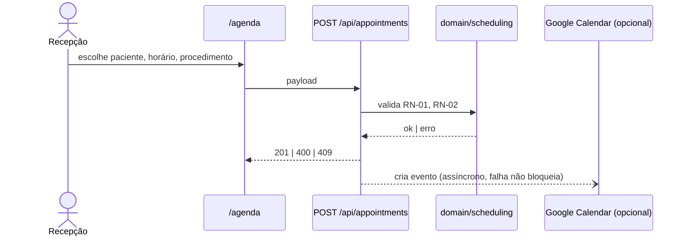

<!--
  COMO USAR ESTE TEMPLATE
  - Salve em docs/domains/<domínio>/features/<funcionalidade>.md e linke no README do domínio.
  - Frontmatter: troque status para living quando a funcionalidade estiver entregue.
  - Este é o doc VIVO: descreve como o sistema se comporta HOJE. Atualize no mesmo PR que muda
    o comportamento. O plano de execução de uma mudança vai em .specs/features/<slug>/ (congelado).
  - Use os termos do CONTEXT.md. Termo novo? Adicione lá primeiro.
  - Cada seção abaixo é independente: uma LLM deve conseguir ler só "Resumo" + "Regras" e agir.
  - Seção que não se aplica: escreva "n/a — <motivo>", nunca apague.
-->

# <Nome da funcionalidade>

## Resumo

> **Em uma frase:** <quem> consegue <fazer o quê> para <obter qual valor>.

| Campo | Valor |
| --- | --- |
| Domínio | [<domínio>](../README.md) |
| Atores | <Recepção, Profissional, Paciente (portal), Super Admin…> |
| Rotas de UI | `/<rota>` |
| Rotas de API | `POST /api/<recurso>` · `GET /api/<recurso>/[id]` |
| Estado | entregue · em-andamento · especificado |
| Roadmap | `RM-NN` · issue #<n> |

## Contexto e valor

**Problema (presente, sem solução dentro):** <o que é verdade hoje e não deveria; quem paga; quanto custa>.

**Resultado esperado:** <o que muda para o usuário quando isto existe; métrica se houver — não invente>.

## Regras de negócio

Uma regra por linha, identificada, com valor concreto. É a seção que LLMs mais consultam — sem
adjetivos ("rápido", "adequado").

| ID | Regra | Garantida por |
| --- | --- | --- |
| RN-01 | <Uma consulta só pode ser marcada em dia útil, 08h–18h no fuso `TZ`.> | `src/domain/scheduling/…` · teste `tests/…` |
| RN-02 | <Entre duas consultas do mesmo profissional há folga mínima de 15 min.> | trigger `endsAtBuffered` |
| RN-03 | <…> | <código ou "decisão pendente — pergunta #1"> |

**Invariantes de segurança herdadas:** escopo por empresa (`sessionScope`/`writeScope`), autorização
em duas camadas (ADR-002). Liste aqui só o que for **específico** desta funcionalidade.

## Casos de uso

### UC-01 — <verbo + objeto, ex.: "Agendar consulta pela recepção">

| Campo | Valor |
| --- | --- |
| Ator primário | <papel> |
| Pré-condições | <sessão ativa com papel X; paciente cadastrado> |
| Gatilho | <ação do usuário ou evento> |
| Pós-condição de sucesso | <o que persiste / o que o ator vê> |

**Fluxo principal**

1. <Ator> <ação>.
2. Sistema <valida RN-01, RN-02>.
3. Sistema <persiste / notifica>.

**Fluxos alternativos e de exceção**

- **1a.** <condição> → sistema <resposta com código/mensagem literal>.
- **2a.** Viola RN-02 → `409` com `"Conflito de agenda"`.

### UC-02 — <…>

## Fluxo de valor

Do gatilho ao valor entregue, cruzando atores e sistemas. Use `sequenceDiagram` quando houver
integração externa; `flowchart` quando houver decisão/ramificação.



## Critérios de aceite

Um cenário por comportamento observável. Valores literais (status, texto, campo). Todo `RN-NN`
aparece em pelo menos um cenário. Casos de erro são cenários, não notas.

```gherkin
# language: pt
Funcionalidade: <Nome da funcionalidade>
  Como <ator>
  Quero <ação>
  Para <valor>

  Contexto:
    Dado que estou autenticado como "<papel>" na empresa "Clínica A"

  @RN-01 @UC-01
  Cenário: <caminho feliz>
    Dado <estado inicial>
    Quando <ação>
    Então <resultado observável com valor literal>

  @RN-02 @UC-01
  Cenário: <violação de regra>
    Dado <estado>
    Quando <ação>
    Então a resposta tem status 409
    E a mensagem exibida é "<texto literal>"

  @RN-01
  Esquema do Cenário: <regra com várias entradas>
    Quando tento agendar às "<hora>" de "<dia>"
    Então o resultado é "<resultado>"

    Exemplos:
      | dia     | hora  | resultado |
      | segunda | 08:00 | aceito    |
      | sábado  | 10:00 | recusado  |

  @isolamento-empresa
  Cenário: dado de outra empresa é invisível
    Dado que existe um registro da "Clínica B"
    Quando consulto a listagem
    Então o registro da "Clínica B" não aparece
```

**Estados de tela cobertos:** vazio · carregando · erro · sem permissão — cada um com cenário ou `n/a — <motivo>`.

## Fora de escopo

| Excluído | Por quê |
| --- | --- |
| <capacidade> | <motivo; link para issue/roadmap se for "depois"> |

## Perguntas abertas

| # | Tipo | Pergunta | Bloqueia |
| --- | --- | --- | --- |
| 1 | produto | <decisão que é do usuário> | RN-03 |

## Rastreabilidade

| RN / UC | Cenário(s) | Teste(s) | Código |
| --- | --- | --- | --- |
| RN-01 | `@RN-01` | `tests/domain/scheduling/….test.ts` | `src/domain/scheduling/…` |
| RN-02 | `@RN-02` | `e2e/agenda.spec.ts` | trigger `endsAtBuffered` |

## Histórico

| Data | Mudança | PR / spec |
| --- | --- | --- |
| YYYY-MM-DD | criação | #<n> · `.specs/features/<slug>/` |
